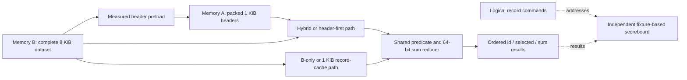
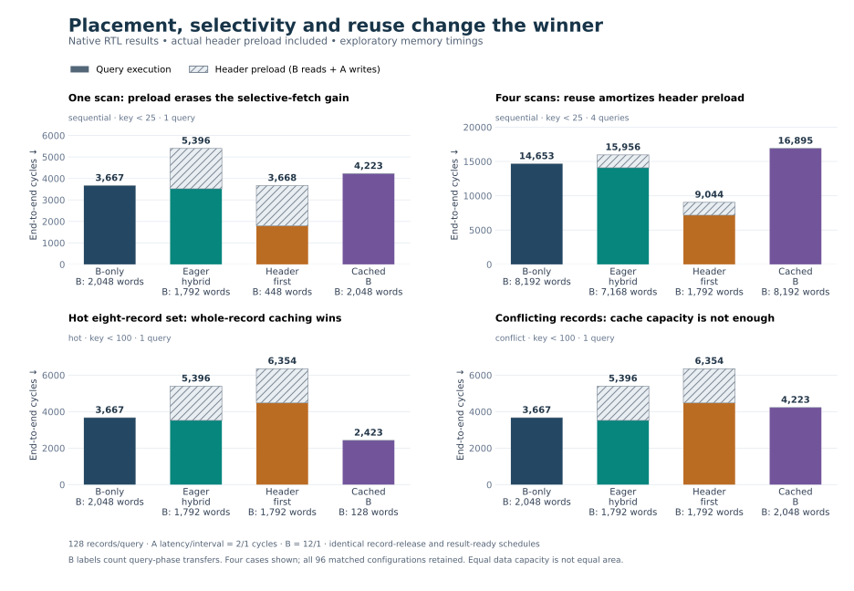
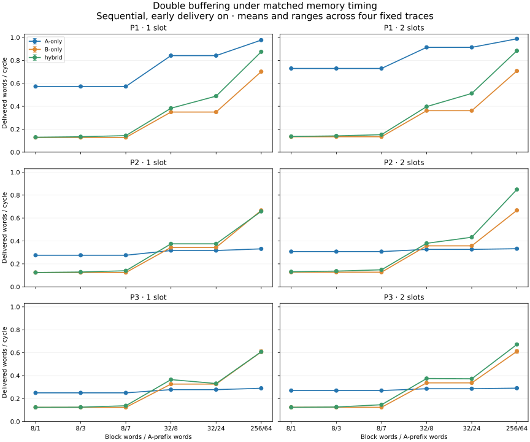

# FPGA record analytics over split memory

**SystemVerilog · native Verilator simulation · finite data placement · independent scoreboarding · reproducible benchmarks**

Filter records by a key, sum the selected payloads, and return ordered results—even when memory and the result consumer stall. This project implements that useful computation over one logical record address space and compares four memory architectures: prefetched B-only, eager split-memory, conditional header-first fetching, and a whole-record cache.

The application builds on a verified one/two-slot streaming core. A finite 1 KiB store holds packed headers, B holds the authoritative 8 KiB dataset, and actual memory transactions preload the headers. Setup cost, rejected payload traffic, cache reuse and completion tails are part of the experiment. This is an **AI-assisted, simulation-first FPGA portfolio project**; no synthesis or physical-device performance is claimed.

**Completed evidence:** 384 native application benchmark runs check 122,880 record results; 40 directed outcomes and four update/reload outcomes pass. The core comparison independently consolidates 2,616 preserved RTL runs. Read the [application report](docs/application-results.md), [core evaluation](docs/stage6-results.md), or [technical case study](docs/portfolio.md).

## What it does

Each of 128 records contains an ID, a key and fourteen unsigned 32-bit payload samples. A query selects `key < threshold` and emits `{id, selected, sum}` for every record. The 64-bit sum is zero for rejected records. A shared synthesizable reducer supplies ready/valid results and holds them stable under backpressure.



| Alternative | Why compare it? |
| --- | --- |
| `b_only` | Strong simple baseline: two assembly slots and early delivery |
| `hybrid` | Fetch headers and payloads concurrently; may waste payload traffic on rejection |
| `header_first` | Fetch payload only after a matching header; avoids rejected work but adds a dependency |
| `cached_b` | Reuse complete hot records in a 16-line direct-mapped cache; expose cold and conflict costs |

All alternatives use the same consumer and logical workload. The cache and packed-header store each hold 1 KiB of data, but tags, interfaces and assembly capacities differ. These are explicit resource assumptions, not equal synthesized area. The [application contract](docs/application-contract.md) gives the exact placement and protocol rules.

At the base timing point, header-first uses **38.3% fewer end-to-end cycles than B-only across four selective scans**, after paying preload. On one scan it loses by one cycle. A whole-record cache wins the hot all-match workload, while B-only wins the cache-conflict workload. The experiment exposes where placement and reuse help, and where their costs dominate.



## Run a native query

Requires Bash, Python 3, a native C++ toolchain, Make and Verilator with `--binary` / `--timing`. See [setup](docs/setup.md). The recorded native environment uses Verilator 5.048 on macOS arm64; Linux/WSL commands are documented without claiming a completed platform port.

```sh
python3 examples/query_records.py examples/sensor_records.csv --threshold 25
```

Read `build/query-demo/query_results.csv` for native RTL results. Supply your own CSV with the [example format](examples/README.md), or select `--arch b_only`, `hybrid`, `header_first` or `cached_b`. Choose a new `--output-dir` when repeating a query. Inputs contain 1..128 records with unique IDs, keys in 0..99 and fourteen unsigned 32-bit samples; shorter inputs are padded, and performance includes that padding. Python converts files and copies native result fields; exported answers come from the accelerator simulation.

The [native runner](scripts/test_application.sh) also supports `--query --dataset-hex`, selectable workloads, memory timing points and repeated queries. It preserves exact result values, latency and traffic records. The sample CSV has been executed through all four architectures with identical 128 results and 32 selected records at threshold 25.

## Core evidence

| Evidence | Recorded result |
| --- | --- |
| Matched core benchmark | **2,616 native RTL runs**, 436 configurations × three modes × two capacities |
| Independent data checking | **98,755,968 output words** checked in that benchmark |
| Reference compatibility | **1,308 depth-one record sets** match historical shared fields exactly |
| Directed controller verification | **229 Stage 4 outcomes**, including 13 named expected failures |
| Seeded stress and faults | **232 Stage 5 outcomes**, including eight matched clean/fault pairs |
| Default P0, two slots, N=8 / S=3 | A: **0.333333**, B: **0.571429**, hybrid: **0.727273 words/cycle** |

That selected P0 core case gives hybrid **27.3% higher steady throughput than B**, its stronger baseline, at equal assembly depth. Hybrid has two source interfaces; this is not an equal-cost hardware claim or an application result.

The losses are retained: full-rate A wins every recommended quiet P1 sequential case at either depth. Across 1,308 depth comparisons, two slots improve 1,231, tie 69 and regress in eight. Three rankings change with a longer window; one P2 hybrid mean-latency win comes with a worse p99 than A. See the [core report](docs/stage6-results.md) and [complete tables](results/double-buffer-tables.md).



## Reproduce and inspect

```sh
# Strict lint, native smoke and accounting checks
bash scripts/check_core.sh --quick

# Native application correctness and named expected failures
bash scripts/test_record_reduce.sh
bash scripts/test_record_cache.sh
bash scripts/test_application.sh --verify-only

# Full application comparison and independent report checks
bash scripts/test_application.sh
python3 tests/test_application_accounting.py
python3 tests/test_application_report.py
python3 benchmarks/report_application.py

# Complete historical-to-current core evidence chain, in a fresh source checkout
bash scripts/reproduce_core.sh
```

The source-only package has been tested in separate directories: the full 4,002-run core evidence chain and 384-run application matrix reproduce the development results. See the [validation receipt](results/reproducibility-summary.json). This reuses the existing toolchain and may reuse source-keyed compiler caches; it is not an independent-platform claim.

The public source package omits the bulky development raw archive. The reproduction commands generate native logs, exact inputs, per-record/per-block CSVs and source hashes locally. [Reproducibility](docs/reproducibility.md) distinguishes fresh runs from auditing existing evidence and records commands actually executed. Optional figures use [pinned plotting dependencies](benchmarks/requirements-plot-lock.txt). Build products and local tools remain ignored.

| Inspect | What it shows |
| --- | --- |
| [Application results](docs/application-results.md) | Useful computation, finite placement, alternatives, setup costs and measured outcomes |
| [Technical case study](docs/portfolio.md) | Ownership, synchronous reads, a cycle walkthrough and verification reasoning |
| [Architecture](docs/architecture.md) / [two-slot contract](docs/stage4-contract.md) | Ready/valid stability, head ordering, memory ports and reset semantics |
| [Stage 5 results](docs/stage5-results.md) | Recorded seeds, reset witnesses, checker faults and finite coverage limits |
| [Memory timing](docs/memory-timing-proposal.md) | P0–P3 model contracts, locality, reservations and shared return arbitration |
| [Reproducibility](docs/reproducibility.md) | Tooling, evidence regeneration and validation scope |

`rtl/` contains the synthesizable controller, reducer and cache; `sim/models/` contains behavioral memories; `sim/tb/` contains native testbenches and independent checkers. `tests/`, `benchmarks/` and `scripts/` orchestrate runs. Historical controllers remain reference implementations.

The user supplied the hypothesis, requirements and project decisions. AI produced implementation, tests, tooling, analysis and documentation under that direction. The core's original replicated-data experiment and the finite-placement application are separate evidence sets. No universal speedup, novelty, physical-memory advantage, BRAM utilization, timing closure or measured hardware bandwidth is claimed.
