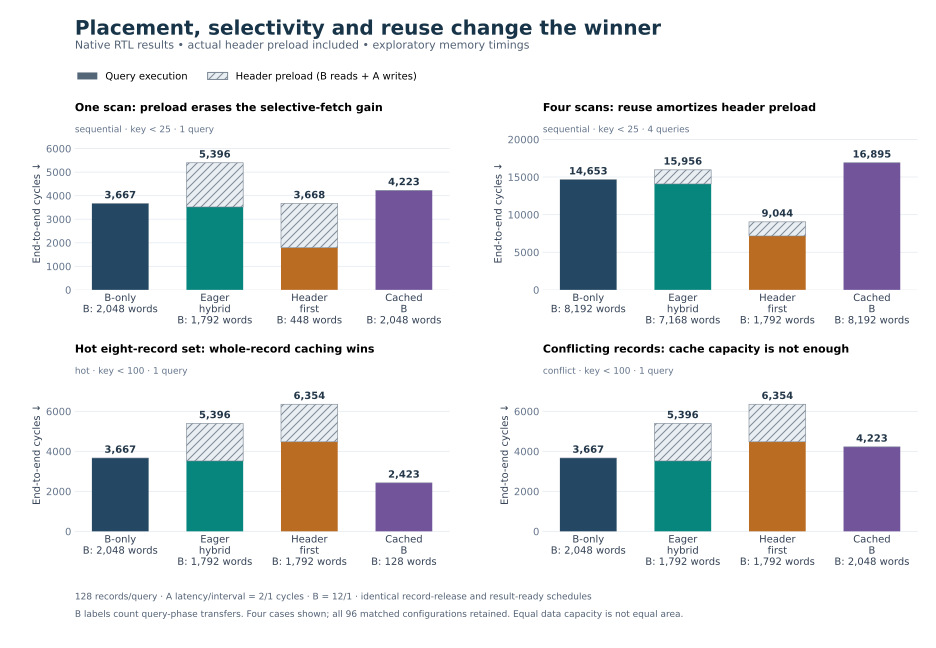

# Finite-tier record analytics

The application extension turns the core's ordered stream into useful work: a predicate selects records, and a synthesizable reducer computes each selected record's unsigned 64-bit payload sum. Every record produces an ordered `{id, selected, sum}` result, including rejected records with sum zero. The [predeclared contract](application-contract.md) defines the workload, alternatives, resources and metrics.

The final source-matched campaign passes **384 native benchmark runs**, forming **96 matched four-way configurations** and checking **122,880 completed record results**. The separate correctness campaign passes **40 directed outcomes**, and four further native outcomes verify quiescent update/invalidate/reload. The public [summary](../results/application-summary.json), [complete tables](../results/application-tables.md), [per-run metrics](../results/application-metrics.csv) and [paired comparisons](../results/application-comparisons.csv) retain both winners and losers. Core benchmark numbers remain a separate evidence set.

## Findings, including setup cost

The table below uses the base exploratory timing point: A latency/interval 2/1 cycles and B 12/1. Every value is **preload plus query cycles**; lower is better. Header modes pay 1,876 cycles to load their 256 header words before these queries. All four alternatives use the same release and consumer-readiness schedules.

| Workload | Threshold | Queries | B-only | Eager hybrid | Header-first | Cached B |
| --- | ---: | ---: | ---: | ---: | ---: | ---: |
| Sequential | 25 | 1 | **3,667** | 5,396 | 3,668 | 4,223 |
| Sequential | 25 | 4 | 14,653 | 15,956 | **9,044** | 16,895 |
| Hot eight-record set | 100 | 1 | 3,667 | 5,396 | 6,354 | **2,423** |
| Cache-conflicting set | 100 | 1 | **3,667** | 5,396 | 6,354 | 4,223 |

**Selective fetching needs enough reuse to repay placement.** On one threshold-25 sequential scan, header-first's query phase takes 1,792 cycles, but preload raises total cost to 3,668—one cycle slower than B-only. Over four actually executed queries, its 9,044-cycle total is **38.3% lower than B-only's 14,653**. Eager hybrid remains slower after setup because it fetches all payloads, including those rejected by the predicate. This is a conditional result for the recorded workload and timings.

**Whole-record caching is a strong alternative.** On the hot-set all-match case, cached B finishes in 2,423 cycles, **33.9% fewer than B-only**. It has eight misses and 120 hits, transferring 128 B words instead of 2,048. The equally small conflict workload maps eight records onto one direct-mapped line; it gets no hits, and cache overhead makes it slower than B-only. The capacity number alone does not predict the result.

**A split-memory core gain does not guarantee an application gain.** Eager hybrid can beat a core streaming baseline under selected P0 settings, yet the application must pay actual header preload and rejected payload traffic. Header-first also loses badly when every record matches and the dependent B request delays useful work. The full matrix preserves thresholds 0/25/50/100, all three timing points, both query counts and all four workloads without averaging them into one speedup.



## Data placement and useful computation

The dataset has 128 immutable records, each containing 16 unsigned 32-bit words: an ID, a key and 14 payload samples. A query selects `key < threshold`. Memory B holds all 2,048 words (8 KiB). Header-placement designs use a finite 256-word (1 KiB) A store containing only packed headers. A translates logical header addresses to this packed physical space and cannot supply payloads.

Before a header-mode query starts, actual B requests read the two header words of each record and transfer them into A. The application waits for this preload barrier. The elapsed cycles and 256 transferred words are counted separately, and preload cycles are added to the cost-inclusive completion number. B-only and cached-B start cold without a header preload.

The shared [record reducer](../rtl/record_reduce.sv) captures the ID, evaluates the key, and adds 14 payload values only for selected records. It accepts a full record or a short, rejected record ending after the key. A one-result holding register maintains ID, selection and sum across result backpressure. A selected record cannot terminate early. Fourteen maximum unsigned 32-bit values sum to 60,129,542,130, which fits the 64-bit accumulator.

## Alternatives and resource assumptions

| Design | Data path | Local data capacity beyond authoritative B | Relevant tradeoff |
| --- | --- | --- | --- |
| `b_only` | Existing two-slot B-only core → shared reducer | 128 B assembly storage | Fetches every complete record; no placement setup |
| `hybrid` | Existing two-slot core: A headers and concurrent B payloads → reducer | 1 KiB packed headers + 128 B assembly storage | Starts headers early but eagerly fetches rejected payloads |
| `header_first` | A header → predicate → conditional B payload → reducer | 1 KiB packed headers + 64 B assembly storage | Skips rejected payloads; serial conditional requests can delay selected records |
| `cached_b` | Same two-slot B-only core, backed by a 16-line whole-record cache → reducer | 1 KiB cache data + tags/validity + 128 B assembly storage | Reuses whole hot records; cold misses and direct-mapped conflicts require B refills |

Byte counts above describe logical data arrays. They exclude bank output registers, tags, control and result state where not explicitly listed; they are not synthesized area or BRAM utilization. Matching A's and the cache's 1 KiB data capacity does not match exact physical cost. Header-first deliberately has fewer assembly resources and remains a separately labeled conditional-fetch alternative.

The [header-first scheduler](../rtl/header_first_controller.sv) holds one command through its final output handshake. It buffers data with synchronous reads, issues B only after accepting a selected key, and emits rejected records with `last` on the key. A held final word retains ownership. The [cache](../rtl/record_cache.sv) accepts aligned whole-record requests, marks a line valid only after its complete refill, and invalidates state on shared reset.

## Evaluation method

The declared matrix varies sequential, recorded-seed permuted, hot-eight-record and cache-conflicting workloads; thresholds 0/25/50/100; three A/B timing points; and single/repeated queries. The reverse-favorable point gives B the shorter initial latency so that an assumed A advantage does not define the conclusion. Identical output-ready schedules are aligned to query workload start for all alternatives, independently of DUT validity. Record `i` has the same exogenous release edge `2*i` in every design. Release-to-result latency includes waiting to offer or accept the command; offer-to-result and accepted-command-to-result distributions are reported separately.

The application scoreboard derives expected ID, predicate result and sum from each accepted logical command address and the input fixture. It does not inspect bank indices, cache tags, the split or DUT validity counters. Result order, rejection semantics and all arithmetic are independently checked. Shared-reset scenarios cancel the whole epoch; deliberate result faults must match named sum, selection, ID or missing-result diagnostics.

The report must retain query-only and preload-inclusive cycles, completed records, selected results, per-record completion tails, A/B words, rejected eager payload traffic, cache hits/misses and exact configuration/source/input hashes. Setup amortization and cache warming are distinct effects. Results across different workloads or timing points must not be collapsed into a universal speedup.

## Executed checks and reproduction

| Executed check | Result |
| --- | --- |
| `bash scripts/test_application.sh` | 40 directed outcomes, four update outcomes and all 384 benchmarks pass against final source hashes |
| `python3 benchmarks/report_application.py --check` | Complete matrix, pairing, source/input/log hashes, independently recomputed results and traffic pass |
| `python3 tests/test_application_accounting.py` | Seven host accounting/fixture tests pass, including deliberately damaged result fields, traffic, release edges and update phases |
| `bash scripts/test_record_cache.sh` | Ten native cache outcomes pass: hits/collisions/stalls, four reset states and five named expected failures |
| `bash scripts/test_record_reduce.sh` | One positive native scenario and two named expected failures pass |
| `.venv/bin/python benchmarks/plot_application.py` | Audited PNG/SVG generated and visually inspected; [figure provenance](../results/application-plot-provenance.json) retained |

The final correctness set has five positive and five expected-failure cases per architecture. It includes no/all matches, strong result backpressure and shared reset with an active B owner and unfinished commands. Fault wrappers exercise incorrect sum, selection, ID and missing-result diagnostics; an out-of-range request must trigger the appropriate architecture/model guard. No compile error or generic timeout counts as an expected-failure pass. Initial testbench preload scheduling and expected-diagnostic issues were corrected before the full source-matched rerun; retained development logs distinguish those attempts from final evidence.

Native logs, exact argv, seed 9173, fixture/order/source hashes and per-record ledgers are generated under `results/raw/application/`. Both update epochs are retained. The public source snapshot omits the large raw archive; the self-contained application runner regenerates it. See [reproducibility](reproducibility.md).

To run useful work on the supplied synthetic sensor CSV or a file with the same schema:

```sh
python3 examples/query_records.py examples/sensor_records.csv --threshold 25
```

The wrapper exports native `{id, selected, sum}` values to `build/query-demo/query_results.csv`. Use a new output directory for another run. It accepts 1..128 input rows; shorter inputs are padded to the fixed geometry, and timing includes padding. The [example guide](../examples/README.md) describes the format and architecture selector.

`bash scripts/test_record_reduce.sh` passes one native directed scenario and two expected failures. The positive scenario checks selected maximum-value payloads, full rejected records, a short rejection exactly at the threshold, a selected sum of 1 through 14, result stalls and reset during partial accumulation followed by a fresh record. The negative runs match `REDUCE_SHORT_SELECTED` and `REDUCE_RECORD_LENGTH`. Logs are in `build/application-reducer/`.

Strict standalone Verilator `--lint-only --timing --assert -Wall` checks pass for `record_reduce` and `header_first_controller`. These module checks do not substitute for the integrated application campaign.

## Quiescent updates and reloading

The [update addendum](application-update-contract.md) adds four directed native outcomes, one per architecture. Each runs and drains a hot-set query, waits a 20-cycle quiet guard, and performs two actual ready/valid writes to B. Record 0's key changes from selected to rejected; one payload value in still-selected record 1 becomes `0xffffffff`. The oracle updates those logical addresses independently.

Shared reset then invalidates the cache/header state for three edges while B retains the updated data. Header designs repeat the actual 256-word preload, and every design runs the same query again. Both epoch result ledgers, the two write handshakes, preload phases, reset and query durations are retained and checked. This verifies an explicit host-managed drain/update/invalidate/reload sequence. Concurrent updates and coherence remain outside the design.

All four cases change from 64 to 48 selected results and correctly return the modified payload sum. Including both epochs, the quiet guard, two write cycles, three reset cycles and any header reload, totals are **7,359 / 10,817 / 8,707 / 4,871 cycles** for B-only / hybrid / header-first / cached B. Header reload costs 1,876 cycles per epoch; the cache is explicitly cold again after invalidation. These are measured phases of the bounded update experiment, separate from the 384 benchmark runs.

The behavioral storage accepts one update write per cycle in this experiment. These model writes and the host-controlled preload sequence do not constitute a synthesized write/preload engine or evidence of physical-device update bandwidth.

## Limits

This is an analytical scan primitive with immutable query epochs, not a complete database or networking stack. Predicate and record format are fixed; threshold stays constant within an epoch. There is no concurrent update engine, cache coherence, runtime mode selection or device integration. The executed quiescent update protocol uses behavioral memory writes; further break-even extrapolation is a cost scenario. Memory timings and service limits remain exploratory simulation inputs.


## Source-only reproduction

The reviewed public source snapshot was executed in a separate directory without copied build products or raw evidence. All 384 benchmark record CSVs are byte-identical to the development reference; all metrics and the four two-epoch update results match exactly. The same source hashes were verified. Source-keyed native compiler caches on the same macOS host could be reused; this is path/package reproducibility, not an independent compiler or operating-system qualification. The published CSV demo also runs from that snapshot.

The strengthened report additionally passes fourteen deliberate provenance tests: mislabeled timing, self-consistent wrong controls, changed seeded workload/fixture manifests, wrong recorded arguments and fault diagnostics all reject. These are analysis-integrity tests, separate from the seven measurement-accounting tests and the native RTL outcomes.
