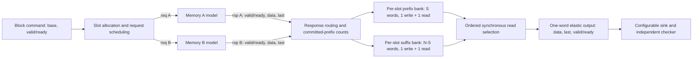
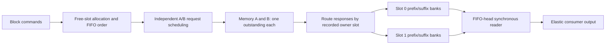

**Current architecture — 2026-11-02:** the unchanged one/two-slot common core is consolidated in [Stage 6](stage6-results.md). The separately authorized [finite-tier application](application-contract.md) adds packed header placement, a predicate/64-bit-sum consumer, conditional fetching and a whole-record cache. These additions use the same ready/valid and shared-reset principles; they do not change the historical controller contract below. Application execution evidence is reported separately.

# Approved architecture and single-buffer implementations

The user approved this architecture on 2026-10-21. Stage 2 implements the single-slot A-only/B-only subset. Stage 3 now implements concurrent split requests in one slot; two-slot behavior remains the Stage 4 proposal. Current validation is recorded in PROJECT_STATUS.md; no synthesis has been performed. Memory A/B are configurable architectural models; their usual latency/bandwidth ordering is a hypothesis, not a physical DDR5/GDDR7 claim.

## Recommended scope and parameters

One clock, synchronous active-high reset, read-only aligned fixed-size blocks, ordered responses, at most one outstanding request per memory interface, and a configurable streaming sink. No CPU, coherence, physical memory controller, or device target.

| Parameter | Approved supported range / default |
| --- | --- |
| Word and interface beat | Fixed 32 bits, 4 bytes, one word per beat on each interface |
| Logical address | Unsigned 32-bit **word address**, not byte address |
| `BLOCK_WORDS = N` | Powers of two from 1 through 256; review examples use 8, initial default 8 |
| `SPLIT_WORDS = S` | Compile-time integer 0 through N, fixed during a run; initial default 3 |
| `BUFFER_COUNT` | 1 initially; 1 or 2 after Stage 4 |
| Mode | A-only, B-only, hybrid; selected per build, never switched in flight |
| Consumer capacity | At most one word per cycle; configurable ready pattern independent of valid |

Elaboration/simulation startup checks reject invalid parameters; command assertions reject misalignment (`base % N != 0`) or address overflow (`base + N - 1 > 2^32 - 1`, calculated at widened precision). In an integration build, the caller must obey those preconditions; the MVP has no error-response channel. Define counter widths with room for N, and address widths with a minimum of one bit to handle N=1. Generate away zero-length banks/requests at S=0 and S=N. Wider or multiword beats are an explicit future extension, not silently accepted parameters.

## Dataflow and storage ports

Each logical slot contains two physical bank descriptions: prefix [0,S) and suffix [S,N). Each bank needs **one synchronous write port and one synchronous read port** on the common clock. A and B can write concurrently because they write separate banks. Only one bank is read globally per cycle. Two logical slots mean four banks, before optimizing away zero-length banks. This avoids pretending one ordinary two-port RAM can accept two writes plus a read every cycle.

Data storage is exactly `BUFFER_COUNT * N * 32` bits logically, plus bank output registers, counters and metadata. The enabled bank output registers and selection tag implement one logically occupied output holding slot; there is no extra shared data register in addition to those bank outputs. Physical BRAM utilization may be much larger for small banks and varies with geometry. Use the same bank partition and registered output arrangement for every baseline in a matched comparison; report physical cost separately if synthesis becomes available.

Do not reset the data arrays. Reset metadata and output validity. Bank read outputs may remain stale while invalid. Do not depend on same-address read-during-write mode: only read a word committed before the current edge, and write each bank address once per slot allocation. The suggested coding style is compatible in principle with synchronous FPGA RAM, but **BRAM inference is unverified**. AMD's [simple dual-port examples](https://docs.amd.com/r/2022.2-English/ug901-vivado-synthesis/Simple-Dual-Port-Block-RAM-Examples) and [memory resource guide](https://docs.amd.com/api/khub/documents/9gZGbqBxtlKXxBfkBt~lAg/content) are implementation references, not evidence of inference for this project.

## Exact channel contracts

All transfers occur on rising edges where `!rst && valid && ready`. A producer asserts valid without waiting for ready. While valid and not ready, valid and all payload fields remain stable until a handshake or reset. Ready may depend on available capacity, not on a promise that a stalled item will disappear. Reset suppresses all valid/ready outputs of active project components; no transaction is counted on a reset edge.

| Channel | Producer → consumer | Payload and meaning |
| --- | --- | --- |
| Block command | Workload driver → controller | `cmd_valid`, `cmd_ready`, `cmd_base_word[31:0]`; exactly N words, implicit FIFO block order |
| Memory request, separately A and B | Controller → memory model | `req_valid`, `req_ready`, `req_base_word[31:0]`, `req_words[8:0]` (1..256) |
| Memory response, separately A and B | Memory model → controller | `rsp_valid`, `rsp_ready`, `rsp_data[31:0]`, `rsp_last`; one word, last asserted only on the final beat |
| Consumer stream | Controller → sink | `out_valid`, `out_ready`, `out_data[31:0]`, `out_last`; last on word N-1 of each accepted block |

No response IDs or response addresses are needed with one outstanding request per interface and ordered beats. Each interface retains `{slot, starting offset, requested count, accepted response count}` from request acceptance through the final response handshake. An interface cannot accept another request on that final-response edge; it becomes available on the next edge. `rsp_ready` is high only for an owned request with remaining capacity and deasserted during reset. Unsolicited responses, incorrect last markers and extra beats are protocol failures in verification, not silently valid data.

`cmd_ready` means a free slot exists. Accepted commands allocate a slot in FIFO order and copy the base address; no requests issue until the following edge at the earliest. There is no combinational bypass from commands or memory responses to output. A completed slot cannot be reallocated on its final-consumption edge; it becomes free afterward.

In hybrid mode both nonempty segment requests become eligible together. Assert them independently when their interfaces are idle; never wait for both ready signals to be high simultaneously. They may be accepted on different edges. Keep each descriptor stable until accepted. Each interface selects the oldest block whose own segment is unissued; it may start that segment of the next allocated block once its previous request completes, even if the other interface is still serving the older block.

### Address and baseline mapping

For block base b, hybrid A requests `[b, b+S)` and hybrid B requests `[b+S, b+N)`. Their returned words write sequentially to their assigned bank offsets. Empty segments generate no request and are considered complete from allocation.

A-only and B-only each request all N words from the selected interface. The accepted beat index routes words below S to the prefix bank and the rest to the suffix bank. Use **one full-block request**, not two segment requests that would unfairly add latency to a baseline. The unused interface remains idle. This preserves identical storage and output logic without pretending that a baseline has two memory resources.

## Early validity, read latency and output stability

For each slot, `prefix_committed` counts sequential words written to the prefix bank (0..S) and `suffix_committed` counts words written to the suffix bank (0..N-S). Increment only on a response handshake that writes the corresponding word. With in-order, contiguous responses, these counts represent per-word validity compactly:

- Word i < S is readable iff `i < prefix_committed`.
- Word i >= S is readable iff `i - S < suffix_committed`.

Use the **pre-edge** committed counts when deciding a read. Never gate early consumption on whole-block completion. B arriving first increases suffix validity but cannot advance the logical next-word index past missing prefix data. Prefix counts are sufficient only because holes and out-of-order responses are excluded; such an extension would require a different validity scheme.

Keep `read_issue_index` separate from `consumed_count`. The former advances on a granted RAM read; the latter advances only on output handshake. A fetched but stalled output is still unread data for ownership and occupancy purposes.

Recommended one-stage elastic read path:

1. Read only the head slot's next logical word, and only when it is committed and the output slot is empty or being consumed (`!out_valid || out_ready`).
2. At edge t, the selected RAM samples its read address/enable. Its registered data, selected-bank tag, word index/last and output-valid state update after that edge. The earliest consumer handshake is edge t+1.
3. If output is stalled, issue no new read and hold the selected bank output, tag, data, last and valid. Gate bank read enables accordingly.
4. If output handshakes and another committed word exists, replace it with a synchronous read at that edge. This permits one word per cycle within a block when data is present. If there is no replacement, clear output valid.

This proposal uses the enabled RAM output register as the holding data stage, with registered selection/metadata; there is **no additional unconditional register** after it. Adding another stage requires explicit capacity for its in-flight result and revised latency tables. For a memory response written at edge w, the earliest read is w+1 and earliest consumption is w+2. There is no write-to-read bypass.

To keep the initial controller simple, do not pre-read across block boundaries. If one block's last word handshakes at t, the next head's first RAM read is at t+1 earliest, and first consumption at t+2. This documented inter-block bubble applies equally to all modes.

## Logical slot lifecycle and reset

Each slot is FREE or ALLOCATED; filling and draining are overlapping activities, not mutually exclusive phases. Track base/order, per-interface request-issued/done flags, committed counts, issued reads and consumed words. Consumption serves only the FIFO head; filling may serve either slot in Stage 4.

Free a slot only when all required response beats have committed, N words have handshaken to the sink, and no held output/read result references it. Do not free it merely because fetching completed or the last RAM read issued. Assert no duplicate writes, count bounds, one interface owner per outstanding request, and no access to a free slot. With two slots, the tail may fill while the head drains; if both are occupied, backpressure commands.

Reset contract: assert synchronous `rst` for at least one rising edge to **controller, both models, sink, command driver and scoreboard together**. At that edge cancel outstanding requests, partial blocks, occupied slots and pending output; clear request descriptors, validity counts, output valid and ownership. Ignore transfers at reset. Do not clear memory data arrays. After deassertion, only newly accepted commands can produce output. The driver explicitly reissues aborted work if desired; the scoreboard discards the aborted epoch rather than requiring its completion.

This cancellation is possible because the behavioral models share reset and erase their pending responses. **Resetting the controller alone while an external memory continues responding is unsupported.** A later external adapter must provide drain/quiesce or response epoch tagging before slots can be safely reused. A checker epoch tag alone does not solve stale responses in hardware.

## Memory timing and sink model

Each interface exposes these separate behavioral parameters, with no fixed requirement that A beats B:

- Initial latency L >= 1: request accepted at edge r makes beat 0 available for earliest handshake at r+L. It is not emitted at r itself.
- Physical modeled bus width 32 bits and payload beat size 4 bytes, explicitly fixed in this MVP. Both peak at one beat per cycle.
- Beat interval I >= 1: after a beat handshakes at t, the next is eligible at t+I, subject to burst gaps. Thus no stalled beat is discarded and no missed bandwidth credits accumulate.
- Burst length K >= 1 and additional inter-burst gap G >= 0: after each Kth accepted beat, add G cycles before the next eligible beat of the same request. Example: I=1, G=2 gives next eligibility t+3. The final beat has no next-beat delay.
- Request cooldown C >= 0: after the last response handshake at t, earliest new request acceptance is t+1+C. One outstanding request; deterministic or seeded acceptance stalls may further delay acceptance.

For a long unstalled request, the timing model tends toward K/(K*I+G) beats/cycle; finite requests omit the trailing gap, and request latency/cooldown reduce workload throughput. Latency, width, beat interval, burst gaps and outstanding limits are all reported separately. B's higher sustained rate initially comes from a smaller interval or fewer gaps, not a secretly wider bus.

No bank-row timing, refresh, arbitration with other masters, command/data bus sharing or shared A/B contention is modeled initially. Backpressure extends the response schedule rather than modeling a deep device FIFO; this is a deliberate simplification. Rate/latency values are exploratory inputs, not calibrated device data.

Sink ready uses a workload-relative periodic pattern (P>=1, 1<=R<=P ready cycles per period) or a recorded bounded seeded stall sequence. The driver schedules ready independently of output valid, data, and DUT progress; reset restarts the schedule. Directed tests may force longer stalls. Deadlock tests distinguish intentionally stalled sinks from missing controller progress.

## Eight-word transaction examples

Both examples use N=8, S=3, base b=0. Command accepted at edge -1; A request `(0,3)` and B request `(3,5)` accepted at edge 0. Words are labeled w0..w7, meaning deterministic data for those logical addresses. Responses are accepted immediately on the listed edges. All table events happen on rising edges; a listed RAM read produces held output after that edge, consumable on the next edge. Blank event means none. These are **hand-derived protocol illustrations, not simulation results**. Use them as directed-test expectations once RTL exists.

### A first, with sink backpressure

A: L=2, I=3. B: L=6, I=1. K>=8, G=C=0. Sink ready is 0 only at edges 11 and 12.

| Edge | Accepted response/write | RAM read issued | Sink ready | Output at edge / event |
| --- | --- | --- | --- | --- |
| 0 | — | — | 1 | No valid; both requests accepted |
| 1 | — | — | 1 | No valid |
| 2 | A:w0 | — | 1 | No valid |
| 3 | — | w0 | 1 | No valid |
| 4 | — | — | 1 | Consume w0 |
| 5 | A:w1 | — | 1 | No valid |
| 6 | B:w3 | w1 | 1 | No valid |
| 7 | B:w4 | — | 1 | Consume w1 |
| 8 | A:w2, B:w5 | — | 1 | No valid |
| 9 | B:w6 | w2 | 1 | No valid |
| 10 | B:w7 | w3 | 1 | Consume w2 |
| 11 | — | — | 0 | Hold w3, valid=1 |
| 12 | — | — | 0 | Hold same w3, valid=1 |
| 13 | — | w4 | 1 | Consume w3 |
| 14 | — | w5 | 1 | Consume w4 |
| 15 | — | w6 | 1 | Consume w5 |
| 16 | — | w7 | 1 | Consume w6 |
| 17 | — | — | 1 | Consume w7, last=1; slot completes |

First consumption is edge 4; the complete block is not stored until edge 10. No read accesses a same-edge write. On edges 11/12 the output holds even though later words are committed.

### B first: suffix must wait for prefix

A: L=7, I=3. B: L=2, I=1. K>=8, G=C=0. Sink always ready. This intentionally reverses the usual latency assumption to test correctness.

| Edge | Accepted response/write | RAM read issued | Output at edge / event |
| --- | --- | --- | --- |
| 0 | — | — | Both requests accepted; no valid |
| 1 | — | — | No valid |
| 2 | B:w3 | — | No valid |
| 3 | B:w4 | — | No valid |
| 4 | B:w5 | — | No valid |
| 5 | B:w6 | — | No valid |
| 6 | B:w7 | — | No valid |
| 7 | A:w0 | — | No valid |
| 8 | — | w0 | No valid |
| 9 | — | — | Consume w0 |
| 10 | A:w1 | — | No valid |
| 11 | — | w1 | No valid |
| 12 | — | — | Consume w1 |
| 13 | A:w2 | — | No valid |
| 14 | — | w2 | No valid |
| 15 | — | w3 | Consume w2 |
| 16 | — | w4 | Consume w3 |
| 17 | — | w5 | Consume w4 |
| 18 | — | w6 | Consume w5 |
| 19 | — | w7 | Consume w6 |
| 20 | — | — | Consume w7, last=1; slot completes |

Although suffix storage is full at edge 6, no suffix word is output ahead of w0..w2. First consumption still precedes full-block arrival (edge 9 versus 13).

## Review decisions

Approved Stage 1 scope (2026-10-21):

1. Fixed 32-bit one-word beats, compile-time block/split, one outstanding request per interface, and an address-based independent scoreboard. This keeps rate effects explicit and routing reviewable.
2. Two segment banks per logical slot, committed-prefix validity counts, synchronous one-cycle reads with an elastic holding output, and the stated inter-block bubble. This supports two concurrent writes and safe early consumption without a three-port memory assumption.
3. Shared cancellation reset, no array reset, with external-memory reset isolation explicitly out of scope.
4. Stage 2 first: buffered A-only/B-only configurations, one slot, same contracts and checker. Hybrid and two slots remain later checkpoints.

The user approved the baseline architecture and then Stage 3 hybrid implementation. Stop at the Stage 3 review checkpoint before implementing double buffering. See verification.md and results.md for required correctness and fairness checks.

## Stage 2 code mapping and walkthrough

- `rtl/single_memory_controller.sv`: one logical slot, compile-time `USE_B=0/1`, both external memory interfaces exposed with the unused one idle. FREE accepts a command; REQUEST holds one full-block descriptor; ACTIVE permits filling and draining together. Receiving all words does not by itself free the slot. Final output handshake releases it.
- `rtl/sync_bank.sv`: enabled synchronous read and synchronous write, one of each per bank, without data reset. Zero-length banks are generated away.
- `received`, `prefix_committed`, `suffix_committed`: response handshakes commit consecutive data. `read_issued` advances on an eligible synchronous read. `consumed` advances only on sink handshakes. Their difference must equal output occupancy (zero or one).
- The selected bank's registered read output holds data; `output_suffix` and `output_last` hold its metadata. No extra output data register or write bypass was introduced.
- `sim/models/behavioral_memory.sv`: fixture-backed source with independent latency, beat interval, burst length/gap, request cooldown and periodic request acceptance. Runtime timing configuration is constant for each simulation and resets restart its schedule.
- `sim/models/stream_sink.sv`: behavioral sink with periodic readiness and an optional fixed cycle stall window, plus accepted-word/block counts and a checksum. This is a test endpoint, not a synthesized compute engine.

The baseline routes its single full-block response stream into the two segment banks; **S only selects the storage partition in Stage 2**. It does not split requests across memories. The eight-word A/B arrival tables earlier in this document describe hybrid behavior; the Stage 3 runner checks their arrival, consumption and hold edges exactly. They are not baseline traces.

## Approved Stage 3 decision: hybrid, still one logical slot

Recommend keeping the same ports, word size, bank read pipeline and independent scoreboard. Replace the baseline's selected-interface request state with independent A/B request-issued/response-owner bookkeeping, so either interface can accept first and either segment can arrive first. For N=8,S=3, base b: A requests `(b,3)`, B requests `(b+3,5)`. Request acceptance on one interface must not wait for the other. Empty segments issue no request. The prefix/suffix counts continue to gate ordered reads; add directed A-first/B-first tests using the existing cycle tables. Keep the passing baseline for fair later comparisons. Two-slot overlap remains Stage 4.

## Stage 3 implementation and review

`rtl/hybrid_controller.sv` keeps one FREE/ALLOCATED slot and the baseline's synchronous two-bank read arrangement. Independent a_sent/b_sent bits mean pending requests are stable and either interface can progress first. A response handshakes only while its accepted request owns remaining bank capacity. Each side writes at its own committed count, so two responses may commit at one edge. Empty segments generate neither a bank nor requests. Read-issued/consumed counts and output metadata retain the approved one-cycle synchronous behavior; the controller never waits for full-block arrival or both request acceptances before reading a valid prefix word. The slot is released on final consumption, after both segments are complete.

The baseline RTL, bank module, memory/sink models and address-only scoreboard are retained unchanged. The hybrid testbench adds public-channel monitors for independent request progress, per-interface timing, simultaneous writes, asymmetric reset, and protocol witnesses. Its split-aware request monitor is separate from the unchanged split-independent end-to-end scoreboard.

### Next review decision: Stage 4 double buffering (not implemented)

Recommend two FIFO-ordered logical slots, each with its own prefix/suffix banks and committed counts. Keep one outstanding request per interface globally. Each interface records an owner slot until its final response; then it can request the oldest allocated block with an unissued segment. Read only from the FIFO head. A free slot accepts the next command while the other drains; a slot is not reusable until its last word is consumed and it has no outstanding response or held output. Keep the existing inter-block read bubble and shared reset contract for initial clarity.

Concrete next-stage example for N=8,S=3: slot 0 owns block base 256 and slot 1 owns base 264. A requests (256,3), then after completing it can request (264,3); B independently requests (259,5), then (267,5). The second block may fill while the first is stalled at the sink. Even if slot 1 fills first, output remains addresses 256..263, then 264..271. Consuming the first block's last word at t frees slot 0 afterward; if the next block's first word is valid, read it at t+1 and consume it at t+2. No request IDs are needed externally, because each interface retains one internal owner slot. 

### Single-buffer benchmark interlude requested before Stage 4

Both existing single-buffer controllers now have `EARLY_DELIVERY` (bit, default 1). Default behavior and all interface/ownership/reset contracts are retained. The explicitly labeled ablation value 0 additionally requires the full block's committed count before issuing the first bank read; no data-valid count is removed and no write/request behavior is changed. Even in the ablation, consumption cannot occur until two edges after the final write. See single-buffer-benchmark-contract.md for matched comparisons and resource accounting. 

### Approved and implemented memory timing extension

The user approved docs/memory-timing-proposal.md on 2026-10-21. Its P1–P3 simulation-only path/service wrapper is implemented; P0 and every production controller/bank port remain unchanged. `profiled_memory_pair.sv` owns one descriptor and one registered response per interface; `timing_calendar.sv` supplies finite reset-relative jitter/reservation events independent of the DUT. P1/P2 allow independent grants; P3 supplies at most one word per shared-return edge with work-conserving round robin. Response handshakes can occur later, including during a service pause, without breaking the grant bandwidth limit.

Latency is now a first-handshake lower bound before jitter, row setup and service contention. Each grant produces a response eligible for handshake on the next edge; same-edge replacement after a response handshake permits I=1. No stalled response accumulates future credits. B checks four row tags using bank=(address/256)%4 and row=address/1024, uses absolute chunks capped at 16, and restarts invalidated setup after maintenance. Reset clears descriptor/held validity, row/setup state, deadlines, arbitration and the calendar epoch together with the existing controller/sink/checker; source and bank arrays stay intact.

The source fixture is resident in both source stores; neither source capacity nor preload cost is hidden inside the N-word assembly-buffer budget. Limits, contract changes, diagram and transaction example are in the approved proposal. Its example has now been checked by actual RTL simulation; see memory-timing-results.md. Stage 4 remains a separate unapproved architecture step.

### Stage 4 concrete review checkpoint

## Approved Stage 4 implementation

The user explicitly approved the [two-slot contract](stage4-contract.md) on 2026-10-21. `rtl/buffered_transfer_controller.sv` implements that contract with BUFFER_COUNT=1/2 and MODE=0/1/2. The existing baseline and hybrid modules remain unchanged reference implementations. No boundary bypass, extra outstanding requests or automatic selection is introduced. Stage 4 verification and evaluation are in progress; the earlier review-stop statements are historical.

Stage 4 completion, 2026-10-22: the approved common core is implemented. Its directed tests and all 2,616 matched runs pass; depth one matches all 1,308 historical record sets. Read [Stage 4 results](stage4-results.md) for qualified conclusions. 
