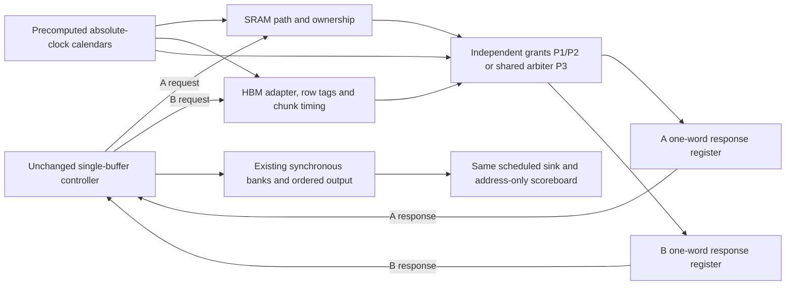

# Memory timing extension proposal — review required

2026-10-21. **Proposal only. No model, controller, test runner or benchmark implementation is authorized by this document.** The user requested this checkpoint before Stage 4, followed by implementation and actual RTL verification only after approval. Double buffering and automatic mode selection are excluded.

Read before preparing this proposal: PROJECT_STATUS.md; architecture.md; verification.md; stage2-contract.md; stage3-contract.md; single-buffer-benchmark-contract.md; and the current results. The existing 78-run benchmark and simple model remain the reference. Existing results do not establish how the proposed profiles will perform.

## 1. Recommended interpretation and placement

Recommend **A = a local on-chip SRAM scratchpad, B = an HBM-backed read service through an AXI adapter** on a hypothetical FPGA platform with HBM. This is an interpretation for architectural experiments, not selection of a board, a commitment to vendor IP, or a claim that the current design fits a device.

- A path: controller request → local request adapter/arbitration → BRAM-backed source scratchpad → registered response. The source scratchpad is separate from the controller's small prefix/suffix assembly buffer. A dedicated SRAM port can stream one word/cycle; lower available A bandwidth must come from an explicit port-sharing policy, not an assumed weakness of SRAM.
- B path: controller request → AXI request/width adapter → HBM controller and selected pseudo-channel → response adapter → registered response. Row state, packet/burst boundaries, controller service interruptions and access-path sharing can affect timing. We model their effects at the existing 32-bit adapter interface, not native HBM signaling.
- Independent profiles have separate A and B return paths. A shared-fabric profile adds a **specific common 32-bit return transport before the two response holding registers**. This represents an integration choice, not an unavoidable connection between SRAM and HBM.

For a fair read-only experiment, preload the same immutable 65,536-word fixture into both source stores before measurement. Logical word address a maps to word a in each store: no split-dependent compaction or relocation. A-only reads the entire block from A, B-only from B, hybrid reads the prefix from A and suffix from B. Each store holds 256 KiB; both copies and their capacities exist in every mode, including an unused interface. The controller's N×4-byte assembly storage is a separate budget.

This residency assumption permits either baseline to serve every tested address. It is not a cache: no misses, replacement, coherence, live migration or automatic selection. Preload/replication cost is excluded and must be reported. A real application exceeding SRAM capacity would need a new placement/capacity experiment; these comparisons must not imply it could serve arbitrary HBM-sized data entirely from A.

A discrete GPU's VRAM would be a different experiment: FPGA → PCIe peer/DMA path → GPU aperture/controller → device memory. Peer access support, topology and transport limits would need specification before assigning B timing. NVIDIA documents PCIe peer access and root-complex/platform restrictions; the VRAM label does not specify that access path. Defer this topology rather than treating local GPU bandwidth as FPGA-accessible bandwidth. [NVIDIA GPUDirect RDMA overview and supported systems](https://docs.nvidia.com/cuda/gpudirect-rdma/)

## 2. Evidence and exploratory values

Sources inspected on 2026-10-21. Facts below are deliberately separated from the proposed simulation constants.

| Authoritative source | What it establishes | What it does not establish here |
| --- | --- | --- |
| [AMD UG573, Block RAM Summary, rev. 1.14](https://docs.amd.com/r/en-US/ug573-ultrascale-memory-resources/Block-RAM-Summary) | BRAM reads/writes are synchronous; optional output pipelining adds a cycle. | End-to-end latency of our scratchpad adapter, available arbitration share, or device fit. |
| [AMD PG276, Performance, release 2025-12-17](https://docs.amd.com/r/en-US/pg276-axi-hbm/Performance) | Published controller latency: direct routing 90 memory clocks for open page and 108 for closed page; global routing minima 110/128. Global latency depends on other traffic; the table supplies no maximum. | Our model's cycles, FPGA clock, or a universal HBM/VRAM latency. These are memory-clock units for that controller configuration. |
| [AMD PG276, Product Specification](https://docs.amd.com/r/en-US/pg276-axi-hbm/Product-Specification) | Ports access HBM through controller/switch resources; direct addressing reduces the access path. | That one narrow model port delivers a whole HBM stack's bandwidth. |
| [AMD PG276, Address Map and Protocol Considerations](https://docs.amd.com/r/en-US/pg276-axi-hbm/HBM-Address-Map-and-Protocol-Considerations) | One active row per bank; changing a row requires precharge/activation. Bank mapping and access order affect efficiency; other streams can disturb locality. | Our small bank/row geometry or exact hit/miss/conflict penalties. |
| [AMD PG276, Reorder, Refresh, and Power Savings](https://docs.amd.com/r/en-US/pg276-axi-hbm/Reorder-Refresh-and-Power-Savings-Options-Tab) | Refresh, page policy and request reordering are controller choices; refresh can be deferred. | A universal fixed refresh interval/pause duration. We will not emulate its command scheduler. |
| [AMD PG276, Lateral AXI Switch Access Throughput Loss](https://docs.amd.com/r/en-US/pg276-axi-hbm/Lateral-AXI-Switch-Access-Throughput-Loss) | Particular lateral paths share bandwidth; stalled traffic can reserve a path. | That every A/B design shares that path, or that its write-stream measurements apply to this read-only model. |

**All proposed profile numbers below are exploratory normalized cycles/words**, not measured or fitted hardware values. In particular, B's base 48 is not a conversion of the sourced 90 memory clocks. No nanosecond, GB/s, achieved FPGA frequency or physical performance claim follows. The sources justify mechanisms; calibration would require a specified device, clock domains, adapter width, mapping and measured traffic.

## 3. Small profile set

Keep `P0-simple` exactly as implemented. Add three named behavior profiles in separate simulation files. Default numbers for a new path-interpretation experiment:

| Profile | Initial path delay before row/service waits | Burst/service behavior | External disturbances and sharing |
| --- | --- | --- | --- |
| P0-simple | Existing per-case L_A/L_B | Existing I/K/G/C semantics | Existing periodic acceptance/sink; byte-for-byte reference behavior |
| P1-locality | A: 2 + J_A(r); B: 48 + J_B(r), plus B row setup | Both peak at one 32-bit word/cycle; B aligned 16-word service chunks, 2-cycle gap between chunks | No background reservations or maintenance; independent A/B paths |
| P2-reserved | Same as P1 | Same physical adapter peak; A's foreground service is reduced by explicit reservations | A reserved on calendar phases 0 and 1 of each 3 cycles; B reserved for 16 consecutive cycles every 256; B maintenance pause 32 cycles every 2,048; independent A/B paths |
| P3-shared-return | Same as P2 | Same endpoint timing, plus one total foreground return grant/cycle | Adds common return fabric; eight cycles reserved per 64 for a distinct fabric client; round-robin A/B on remaining opportunities |

r is the actual request-acceptance edge. J_A is a precomputed clock-indexed value in {0,1,2}; J_B in {0,...,7}. The default B row setup penalty is 0 for hit, 12 for closed bank, 24 for conflict. A has no DRAM row penalty. These are bounded exploratory choices, not vendor timing limits. Set J=0 in exact directed tests.

P1 intentionally allows A full bandwidth. It is the necessary control against manufacturing a hybrid advantage by throttling the faster local store. P2 makes the original lower-available-bandwidth-A hypothesis concrete through sharing. P3 asks whether parallel retrieval still helps after a specified shared transport limit. No profile requires hybrid to win.

B's 16-word (64-byte) chunk is an adapter service quantum, not a claimed native HBM burst. Split a request at absolute chunk boundaries, row-segment boundaries and request end, not by a counter reset to zero at an unaligned suffix. The default chunk is 16 words; an explicit smaller K in a legacy scenario overrides it. Retain the requested address layout. Partial chunks return only requested words; this first extension does not model physical overfetch, byte masks, width conversion or deep burst FIFOs. Report that limitation, especially for tiny blocks/splits. Do not infer physical burst efficiency from it.

The source interface remains 32 bits. P1's maximum aggregate adapter service is two words/cycle; P3's common transport allows at most one. A one-word sink still caps consumption. No aggregation of independently specified A/B peak rates is allowed in a topology with a common bottleneck.

## 4. Address behavior and workloads

Use a deliberately small, documented B geometry for the first extension, allowing the existing fixture to exercise it:

- `column = a % 256`, `bank = (a / 256) % 4`, `row = a / 1024`, integer division, with one open-row tag per bank.
- This is a reduced address mapping, not AMD's physical address map. Keep it identical across modes and split positions. Map each service chunk by its actual logical addresses; the 16-word boundary also prevents a chunk crossing a 256-word row segment.
- Check row state when a chunk reaches its setup/service stage. A hit adds zero setup; an unopened bank adds 12 cycles; a different open row adds 24. Update its row tag when setup completes. Retain open rows across requests; do not restart the memory's row history at a block boundary.
- At a B maintenance-pause start, invalidate B's open-row tags. Cancel an unfinished row-setup attempt and restart that attempt after the pause. Already produced response words remain valid. A completed setup waiting for service must recheck after invalidation. This deliberately conservative service-pause model does not reproduce legal HBM command sequencing.
- Reserved B bandwidth represents clients in disjoint bank/address regions. It does not silently mutate foreground data or row tags. Same-bank background row pollution, bank-group timing and read/write turnarounds are deferred and named as limits.

Workload files will contain explicit aligned base addresses and command release times, generated before simulation. Retain the original 128-block repeating sequential sequence for reference. Add a deterministic permutation of the same address multiset to isolate order/locality (sort the original block indices by a SHA-256 key with a fixed workload seed 7, then repeat the saved permutation); when that footprint cannot generate enough conflicts, add a separately labeled expanded-footprint scatter stream within the 65,536-word fixture. Also use a directed same-bank alternating-row stream. Never claim a footprint change is only an order change. Addresses within each request remain contiguous and responses remain ordered; scatter is **between block commands**, requiring no gather interface or scoreboard redesign.

Primary release policy remains saturation: the same ordered commands are all available from edge 0, and the driver holds the next command until accepted. Their acceptance times naturally differ by mode. An optional fixed-release-time check can expose queueing; it must not redefine the main throughput workload. Sink readiness and external calendars never restart when a command, request or measured block begins.

## 5. Disturbance replay and arbitration

Generate versioned, finite trace files **before any DUT run**, using seeds 11,29,47,83 and a versioned counter-hash generator: interpret SHA-256 of UTF-8 `memtiming-v1|seed|resource|index` as an unsigned big-endian integer. Use index `floor(cycle/16)` for piecewise-constant jitter, modulo 3 for A and modulo 8 for B. Use distinct resource labels ending in `-phase`, index 0, and modulo the corresponding period to select calendar phase. This is a reproducible exploratory schedule, not a fitted noise distribution. Save the full arrays/events, not just a seed. Each record is indexed by absolute reset-relative cycle and resource; it contains jitter values, reservation bits, maintenance state and optional request-acceptance gates. The generator has no DUT signals, request counts, mode or split input. A periodic reservation/pause is active when `(cycle + period - phase) % period < duration`; A uses duration/period 2/3, B reservation 16/256, B pause 32/2048 and shared reservation 8/64. Seeds therefore select phase offsets as well as bounded jitter, so all replicas are not locked to the same disturbance phase. Separate named streams supply A, B, shared fabric and sink events. Keep workload seed 7 fixed while varying the disturbance seeds, so variability does not silently mix address-order changes with environment changes. Existing periodic sink phases stay unchanged; any additional sink trace must be separately labeled and shared across the triplet.

For a matched triplet, the workload, sink and external files and their hashes are identical. A request accepted at r samples J[r]; a faster mode may sample another edge's value. This is the same time-varying environment, not a guarantee that request j receives identical delay in every mode. Row histories and grant histories may also legitimately differ because requests differ.

Background load is initially a **service-reservation calendar**, representing fixed QoS commitments to other clients. Reserved opportunities are unavailable to foreground even if it is idle; they are not banked as credits or reclaimed. This avoids an ambiguous hidden traffic queue. Log reserved opportunities as reserved capacity, not as measured completed external traffic. A maintenance pause and reservation overlap as a union of unavailable cycles, not additive delays. P3's fabric client is distinct from the A/B-local clients, so the topology and accounting expose both constraints rather than accidentally charging one event twice.

Arbitration on each service edge:

1. Apply the fixed local maintenance/reservation and shared-fabric calendar for that edge.
2. Form A/B eligibility from an owned request (or a request accepted on this edge for the L=1, J=0, zero-setup case), expired path/setup/spacing delay, an available local service opportunity, and capacity in that interface's one-word response holding register.
3. P1/P2 grant each eligible independent path, allowing two new words. P3 grants at most one eligible path on an unreserved fabric edge. Round robin starts with A after shared reset; after an actual grant, the next preference is the other interface. No pointer advance on pause, reservation or no grant.
4. If only one interface is eligible, it receives the available grant; an inactive baseline interface does not waste half the link. If both are eligible, they alternate grants. A stalled holding register cannot monopolize P3's fabric. This is a specified beat-level adapter arbiter, not a reproduction of AMD's burst-locking lateral switch.
5. A grant fills/replaces that interface's registered response after the edge; its earliest response handshake is the following edge. Grant permission must never withdraw an already asserted response valid. Allow replacement at an edge where the prior response handshakes, preserving one-word-per-cycle capability.

A shared service cap constrains **new words transported into response registers**, not necessarily simultaneous later handshakes from previously filled registers. Log both events and assert cumulative conservation: transported foreground words = response handshakes + held words (minus reset-aborted held words). Include each endpoint's one-word response register in model capacity accounting, identically across modes; no additional block-sized response cache or hidden request prefetch.

No externally scheduled event may be consumed only when a DUT asks for work. Trace exhaustion is a named failure, never implicit wraparound, zero filling or a mode-specific random continuation. Choose length from an explicit conservative run bound and record missing-progress/total timeout limits. Validate the intersection of local and shared calendars, not just their individual duty cycles: enumerate their combined repeat period to bound the longest eligible-service gap for each path, then account for round robin, bounded jitter/setup, configured I/G/C, descriptor acceptance and sink gaps. Reject configurations with no progress opportunity rather than calling a stalled run a valid benchmark. If a trace is too short, regenerate the entire matched set before running any comparison.

## 6. Proposed interface and contract changes

No production controller ports, widths, block ranges, output pipeline or validity logic change. Keep one outstanding request per interface through its **last response handshake**; no acceptance on that same edge. Shared reset also resets new row tags, response registers, trace epoch/cursor, deadlines and round-robin state. Source data and controller RAM arrays remain intact; validity/ownership are cleared. Controller-only reset against a live model remains unsupported.

The new simulation wrapper owns both interfaces because independent `behavioral_memory` instances cannot enforce a joint bandwidth limit. It may instantiate per-interface path engines and a common arbiter, with simulation-only trace/configuration and observation signals. It must offer exactly the existing request/response interface to the controller. The original `behavioral_memory.sv` and original runner remain available without this wrapper.

Changes to timing interpretation must be explicit:

- P0 retains exact `r+L` first response and `previous handshake+I+G` spacing.
- New profiles: L+J is the **uncontended first-handshake lower bound before row setup**. Earliest first grant is `r+L+J-1`; row setup, unavailable service and arbitration may postpone it. Always record first valid as well as first handshake to separate model delay from response backpressure.
- For subsequent words, preserve the no-credit spacing policy: earliest grant is `previous response handshake+I-1`, plus G on a new chunk. Row setup applies at the chunk boundary when eligible. A held response prevents accumulating multiple future words; expired opportunities do not create a burst of catch-up credits. Same-edge replacement is possible only when the prior response is actually accepted.
- Path/spacing deadlines are absolute edge deadlines; row setup can be invalidated/restarted by maintenance as specified. A pause never changes data/last on a held response. Availability after a pause does not bypass outstanding ownership or FIFO order.
- Request ready remains capacity/cooldown/acceptance-gate based. Idle descriptors may be accepted during a service pause and wait; queueing is included in request-to-first latency. The accepted descriptor capacity is one, with no hidden second pending request.
- Replace the old **exact constant-response-timing assertions only in new-model tests** with checks of eligibility, row/setup bounds, calendars and arbitration. Keep all original constant-model monitors untouched. Do not weaken ordered data, last, stability, ownership or synchronous-read assertions.
- A response committed at w still cannot be consumed before w+2. End-to-end checking still derives solely from accepted command addresses, never split/bank/row/grant state.

### Hand-derived arbitration example, to verify after approval

This is a specification example, **not a simulation result**. N=4,S=2; both requests accepted at normalized edge 0; L_A=L_B=2, I=1, J=0, B row already open, no chunk gap; sink and response consumers always ready. Use P3 arbitration with only edge 2 reserved externally and initial preference A.

| Edge | New service grant | Response write to controller | Consumer event |
| --- | --- | --- | --- |
| 1 | A word 0 | — | — |
| 2 | external reservation | A word 0 | — |
| 3 | B word 2 | — | — |
| 4 | A word 1 | B word 2 | word 0 |
| 5 | B word 3 | A word 1 | — |
| 6 | — | B word 3 | — |
| 7 | — | — | word 1 |
| 8 | — | — | word 2 |
| 9 | — | — | word 3, last |

The edge-2 reservation prevents a new grant but cannot revoke A's word already in flight. Suffix word 2 arrives before prefix word 1, yet output stays ordered. The last prefix write at 5 cannot be consumed before 7. This small table tests the new behavior without copying the whole scheduler into the data oracle.

## 7. Verification after approval

Implement incrementally in simulation-only modules; run actual Verilator RTL throughout. No new production controller logic is anticipated.

1. Preserve and rerun the existing 68-outcome correctness suite, lint and smoke. Keep the original model and benchmark harness unchanged; write fresh replay results into a separate directory and compare with the saved reference.
2. Test path timing/row mapping in isolation: fixed known hit/closed/conflict sequences, cold-start, successive same-row requests, bank alternation, row/chunk crossings and unaligned suffix starts. Require witnesses, not merely eventual completion.
3. Test the replay calendar independently: events progress when DUT is idle or stalled; seeds/files reproduce; shared reset restarts the epoch; no event depends on request count; missing/malformed/short traces reject with named diagnostics.
4. Test service accounting/arbitration: exact example above, A-only/B-only full use of available fabric, simultaneous eligibility, fixed rotation, local and shared reservations, overlapping pauses, conservation/capacity bounds, no starvation under bounded schedules. Check expected grants with hand-authored small calendars and conservation assertions, not a copy of the arbiter algorithm as the sole oracle.
5. Test response backpressure during maintenance/arbitration, including held final response. Reset while awaiting service/setup, during pause, after only one request accepts, with one/both response registers occupied and with controller output held. Post-reset fresh addresses expose stale data. A grant must never create an unsolicited response.
6. Use the existing independent address scoreboard. Add named negative wrappers for response withdrawal/payload change, duplicate/drop or wrong last, unscheduled/over-capacity grant and stale response after reset; require the intended error category. Keep faulted runs out of performance reports.
7. Run deterministic cases first, then the four prerecorded disturbance traces. Preserve failing traces/waveforms; no accepting a failure merely because variability was intended. Timing/accounting tests must pass before benchmark admission.

This expands model verification without claiming completion of all Stage 5 work or coverage of every legal memory scheduler.

## 8. Benchmark plan and interpretation

Preserve `results/raw/single_buffer/`, its manifests, charts and docs/results.md unchanged as the historical reference. New results belong under a separate `results/raw/memory_timing/` hierarchy; no new run overwrites old evidence. Record current source hashes and trace hashes. Existing tables must continue to mean what they originally measured.

Two clearly separated timing families avoid silently replacing the old experiments:

- **Legacy-parameter replay:** rerun all 26 existing triplets exactly under P0. Then rerun those same workload/storage/sink/control cases under each new behavior overlay, retaining each case's explicit L/I/K/G/C and request-acceptance parameters. New jitter, B row setup and calendars apply on top; B's chunk maximum becomes `min(case K,16)` with absolute chunk boundaries. These are normalized mechanism/sensitivity experiments. A name such as equal_fast denotes equal *base* timing here; row state/reservations may still differ and must be shown. The original aggregate-rate control remains a separately labeled nominal-input-rate control: after reservations it must not be described as equal available bandwidth without checking actual capacities.
- **Recommended path settings:** additionally use the profile defaults in §3 (A base 2, B base 48; I=1, B chunk 16/G=2, A no extra chunk gap, C=0, unrestricted descriptor acceptance). Retain favorable and unfavorable sampled splits: N=8,S=1/3/7; N=32,S=8/24; N=256,S=64, plus endpoint/boundary correctness. Run early delivery enabled and disabled in all three modes. Use sequential, same-footprint permutation and directed conflict workloads; report expanded scatter separately when necessary. This family gives the proposed physical interpretation a consistent exploratory starting point instead of pretending old L=6 was device-calibrated.

Begin each new overlay's complete legacy matrix with trace 11; assess variability on all recommended-path settings with traces 11,29,47,83, paired across modes. Keep always-ready and the original 1/16-ready slow-sink control; retain the original burst/cooldown and request-skew stress cases in the legacy matrix. No favorable split/trace may be dropped after seeing results. If runtime warrants reducing a cross-product, record the reduction before running it, retaining all three modes, both early-delivery states, unfavorable splits and address patterns.

Use 64 warmup + 1,024 measured blocks initially, then 128+2,048 for representative sensitive cases. Preserve the existing whole/steady window definitions and cycle partitions. Also record how many maintenance intervals each run/window spans; a short run seeing no pause cannot establish behavior under pauses. Preserve a short-startup case. Compare equal work, not simulator wall-clock time; phases remain aligned to reset, never to each mode's warmup completion.

Report for each mode/profile/workload/split/trace:

- Command-to-first word and command-to-complete, plus request-to-first-valid/first-handshake and request-to-complete, request acceptance skew and row-hit/miss/conflict counts.
- Whole-workload intervals and sustained words/cycle, useful/unavailable/intentional/held cycles, slot/backlog occupancy, per-interface service/response rates and shared-resource utilization.
- First-word/completion distributions: min, median, mean, p95, p99 and max. Preserve per-block raw data and time-series plots for pauses/tails. For throughput, report each trace's result and median/min/max across traces, plus fixed-block-window throughput variability. Quantiles over correlated blocks or four traces are descriptive, not independent-sample confidence guarantees.
- Exact whole-time and steady win/tie/loss against **both** baselines. Show paired trace differences and the better baseline; never pool different traces into an apparently precise win. Separate startup-only differences, variance/tail changes and average-rate changes.

Revisit each old conclusion explicitly in a survival/change table: S=1 winning, S=3 earlier first word but B completion tie, long-prefix losses, slow-sink ties, equal-rate losses and request-skew's three-cycle startup effect. For each: old evidence, new per-profile evidence, survives/changes/mixed, and mechanism backed by row/grant/pause events. No new verdict is known yet. Likely mechanisms to test, not results: quiet full-rate A may remove hybrid's advantage; scatter may penalize B; reservations may make overlap useful; a shared return cap may reduce it; rare pauses may change tails while leaving means similar.

## 9. Review checkpoint

Prepared: sourced physical interpretation, explicit residency, three exploratory behavior profiles plus the preserved reference, calendars/arbitration, contract deltas, diagram and hand-derived example, verification and paired benchmark plan. **No new model has been implemented or simulated.** Existing model/RTL/benchmark evidence is preserved; documentation checks are not new simulation evidence.

Recommend approval of the SRAM/HBM interpretation, P1–P3 and the stated bounded reservation model as the next simulation-only step. It deliberately defers GPU/PCIe implementation, native HBM command accuracy, same-bank external interference, deep queues and physical calibration. Approval would authorize this model extension and its verification/benchmarks; it would not authorize Stage 4 or automatic mode selection.

Three understanding questions:

1. Why does identical external traffic mean identical clock-based calendars rather than identical delay for each mode's request number j?
2. Why can a response handshake occur on a reserved transport cycle without violating the shared-bandwidth limit?
3. Why does assuming the entire read-only fixture is resident in A matter to the fairness and applicability of A-only?

Stop here for the user's review before implementation.
