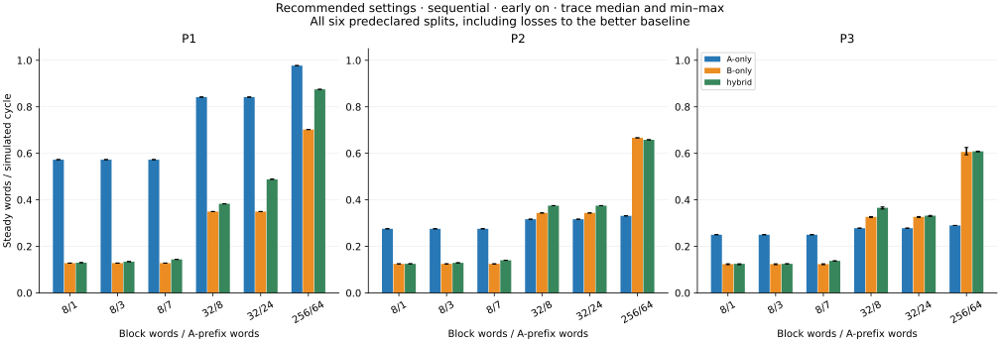

# Memory timing: checked RTL results

The approved simulation-only extension is complete. P0 was replayed in **78 runs**, with byte-identical per-block records and exactly equal metrics. The new models passed **1,230 performance runs / 410 matched triplets** after verification. Stage 4 and automatic selection remain unimplemented.

All numeric timing settings are exploratory normalized cycles. A is interpreted as a local SRAM scratchpad and B as an HBM-backed adapter; the entire immutable 256 KiB fixture is resident in both sources before measurement. Preload cost is excluded. These experiments provide no physical FPGA/HBM performance, area, clock, power or BRAM-inference evidence. See the [approved proposal](memory-timing-proposal.md) for authoritative mechanism references and their limits.

## Validation and reference preservation

- Original 36 baseline/model + 32 hybrid outcomes pass; original smoke and eight measurement tests pass.
- Strict lint passes for all seven tops.
- New model suite: 28 outcomes: 16 positive cases and 12 named expected failures (four trace-file errors and eight protocol/grant faults).
- New controller integration suite: 31 outcomes, including all modes/early settings/four traces, shared reset with a witnessed held output, and the hand-derived grant/output example. Eight new measurement tests include seven deliberate raw-record mutations.

The fixed service example grants A/B/A/B at normalized edges 1/3/4/5; response writes are 2/4/5/6 and controller consumption is 4/7/8/9. Isolated B first-response latencies for the directed closed/hit/conflict/bank/crossing sequence are 14/2/26/14/26/2/14. A setup interrupted by maintenance accepts at edge 20 and responds at edge 76 in its fixed reserved-fabric calendar. These are simulated checks against hand-written expectations.

No controller, bank, address scoreboard, original model, original benchmark harness/runner, or historical result was changed. The saved reference manifest checks 212 files. Fresh P0 evidence is under `results/raw/memory_timing/p0/`; all new-profile records/configurations/logs are separate.

## Fairness and measurement

Each triplet uses the same ordered command addresses, sink readiness, reset origin and finite external calendar files. Disturbance seeds are 11/29/47/83; address order uses fixed workload seed 7. Jitter is sampled at actual request acceptance, so different acceptance times legitimately encounter different conditions. Row and arbitration histories follow each mode’s requests. P3 grants one available word per edge, with work-conserving beat round robin; an unused interface does not reserve half the link. Held responses may handshake on reserved transport edges.

The predeclared matrix (development archive) reduces the address-pattern/slow-sink cross product before execution. Legacy overlays preserve each old L/I/K/G/C/acceptance/sink setting; recommended-path runs use A L2/I1 and B L48/I1/K16/G2. Names such as equal_fast mean equal base parameters in overlays, not equal resulting paths. The aggregate-rate control is supplementary and denotes nominal input rates only after reservations.

Whole intervals are final consumption minus first command acceptance. Whole rate uses the inclusive edge-count window; steady rate uses the 1,024 measured blocks after 64 warmup blocks (or the labeled doubled/short controls). Integer cycle counts determine exact wins/ties/losses. First-word and completion distributions are command-relative; request-relative first valid, first handshake and completion are also retained. Output readiness partitions, occupancy, per-path grants/responses, reserved capacity, row events and pause episodes are logged. Reservations are unavailable capacity, not completed external traffic. Four traces and correlated blocks do not support confidence-interval claims.

## Paired outcomes against both baselines

| Family | Profile | Window | Triplets | vs A W/T/L | vs B W/T/L | Beats both | Loses both |
| --- | --- | --- | --- | --- | --- | --- | --- |
| legacy | P1 | whole | 20 | 13/3/4 | 9/2/9 | 4 | 0 |
| legacy | P1 | steady | 20 | 13/3/4 | 9/2/9 | 4 | 0 |
| legacy | P2 | whole | 20 | 14/3/3 | 7/2/11 | 4 | 1 |
| legacy | P2 | steady | 20 | 14/3/3 | 7/2/11 | 4 | 1 |
| legacy | P3 | whole | 20 | 15/3/2 | 7/2/11 | 4 | 0 |
| legacy | P3 | steady | 20 | 15/3/2 | 7/2/11 | 4 | 0 |
| path | P1 | whole | 24 | 0/0/24 | 24/0/0 | 0 | 0 |
| path | P1 | steady | 24 | 0/0/24 | 24/0/0 | 0 | 0 |
| path | P2 | whole | 24 | 12/0/12 | 20/0/4 | 8 | 0 |
| path | P2 | steady | 24 | 12/0/12 | 19/0/5 | 8 | 1 |
| path | P3 | whole | 24 | 12/0/12 | 22/0/2 | 10 | 0 |
| path | P3 | steady | 24 | 12/0/12 | 19/1/4 | 10 | 2 |

Legacy counts use the same 20 primary cases at seed 11. Path counts use six splits × four traces, sequential, early delivery on. Counts describe these sampled cases, not probabilities. Endpoint ties are included in the legacy matrix.

## Recommended settings: split, latency and variability

| Profile | N/S | A rate median [range] | B rate median [range] | Hybrid rate median [range] | vs A W/T/L | vs B W/T/L |
| --- | --- | --- | --- | --- | --- | --- |
| P1 | 8/1 | 0.572827 [0.572507,0.573108] | 0.127921 [0.127828,0.128074] | 0.129852 [0.129844,0.130075] | 0/0/4 | 4/0/0 |
| P1 | 8/3 | 0.572827 [0.572507,0.573108] | 0.127921 [0.127828,0.128074] | 0.134328 [0.133996,0.134494] | 0/0/4 | 4/0/0 |
| P1 | 8/7 | 0.572827 [0.572507,0.573108] | 0.127921 [0.127828,0.128074] | 0.144006 [0.143939,0.144040] | 0/0/4 | 4/0/0 |
| P1 | 32/8 | 0.841857 [0.841176,0.842452] | 0.349647 [0.349410,0.349906] | 0.383057 [0.382759,0.383157] | 0/0/4 | 4/0/0 |
| P1 | 32/24 | 0.841857 [0.841176,0.842452] | 0.349647 [0.349410,0.349906] | 0.488382 [0.488091,0.489243] | 0/0/4 | 4/0/0 |
| P1 | 256/64 | 0.977130 [0.977070,0.977201] | 0.702332 [0.702163,0.702379] | 0.875114 [0.874892,0.875196] | 0/0/4 | 4/0/0 |
| P2 | 8/1 | 0.275435 [0.274992,0.275909] | 0.124757 [0.124311,0.125008] | 0.125007 [0.124889,0.125130] | 0/0/4 | 3/0/1 |
| P2 | 8/3 | 0.275435 [0.274992,0.275909] | 0.124757 [0.124311,0.125008] | 0.129134 [0.128827,0.129434] | 0/0/4 | 4/0/0 |
| P2 | 8/7 | 0.275435 [0.274992,0.275909] | 0.124757 [0.124311,0.125008] | 0.140303 [0.139743,0.140493] | 0/0/4 | 4/0/0 |
| P2 | 32/8 | 0.316709 [0.316498,0.316764] | 0.343610 [0.343243,0.343804] | 0.374986 [0.374971,0.375010] | 4/0/0 | 4/0/0 |
| P2 | 32/24 | 0.316709 [0.316498,0.316764] | 0.343610 [0.343243,0.343804] | 0.374969 [0.374950,0.375156] | 4/0/0 | 4/0/0 |
| P2 | 256/64 | 0.331188 [0.331173,0.331197] | 0.666665 [0.666660,0.666667] | 0.658215 [0.658076,0.658314] | 4/0/0 | 0/0/4 |
| P3 | 8/1 | 0.250004 [0.249992,0.250038] | 0.123806 [0.121071,0.125017] | 0.124939 [0.121071,0.125019] | 0/0/4 | 2/1/1 |
| P3 | 8/3 | 0.250004 [0.249992,0.250038] | 0.123806 [0.121071,0.125017] | 0.125000 [0.124878,0.125004] | 0/0/4 | 3/0/1 |
| P3 | 8/7 | 0.250004 [0.249992,0.250038] | 0.123806 [0.121071,0.125017] | 0.137805 [0.136684,0.138182] | 0/0/4 | 4/0/0 |
| P3 | 32/8 | 0.278083 [0.278065,0.278129] | 0.326632 [0.324121,0.328205] | 0.365716 [0.360627,0.369800] | 4/0/0 | 4/0/0 |
| P3 | 32/24 | 0.278083 [0.278065,0.278129] | 0.326632 [0.324121,0.328205] | 0.331901 [0.328481,0.333018] | 4/0/0 | 4/0/0 |
| P3 | 256/64 | 0.289908 [0.289895,0.289920] | 0.605966 [0.593573,0.625018] | 0.608592 [0.606200,0.609358] | 4/0/0 | 2/0/2 |

Rates are words per simulated cycle. Complete paired per-trace classifications are in comparison CSV (development archive); every distribution and configuration is in [flat metrics](../results/memory-timing-metrics.csv), and all four-trace ranges in [variability CSV](../results/memory-timing-variability.csv).

| Profile | Mode | First min | First mean | p95 | p99 | max | Complete mean | p95 | p99 | max | Steady rate | 32-block rate range |
| --- | --- | --- | --- | --- | --- | --- | --- | --- | --- | --- | --- | --- |
| P1 | A-only | 5 | 5.97 | 7 | 7 | 7 | 12.97 | 14 | 14 | 14 | 0.572667 | 0.561404–0.585812 |
| P1 | B-only | 51 | 54.464 | 58 | 58 | 68 | 61.464 | 65 | 65 | 75 | 0.128074 | 0.126108–0.129620 |
| P1 | hybrid | 5 | 6.03 | 7 | 7 | 7 | 58.703 | 62 | 62 | 73 | 0.133996 | 0.132437–0.136098 |
| P2 | A-only | 5 | 7.092 | 8 | 8 | 8 | 28.092 | 29 | 29 | 29 | 0.274992 | 0.270042–0.279781 |
| P2 | B-only | 51 | 56.148 | 65 | 69 | 101 | 63.25 | 73 | 76 | 109 | 0.124514 | 0.120926–0.125552 |
| P2 | hybrid | 5 | 7.042 | 9 | 9 | 9 | 60.955 | 74 | 79 | 116 | 0.129126 | 0.124939–0.133125 |
| P3 | A-only | 5 | 9.594 | 14 | 17 | 17 | 31.001 | 38 | 38 | 38 | 0.249992 | 0.248785–0.251721 |
| P3 | B-only | 51 | 56.315 | 63 | 69 | 109 | 63.882 | 72 | 109 | 124 | 0.123301 | 0.118628–0.125245 |
| P3 | hybrid | 5 | 6.992 | 9 | 9 | 9 | 63 | 68 | 73 | 74 | 0.125000 | 0.125000–0.125000 |

This latency table fixes N=8,S=3, seed 11, sequential, early on. Medians and all request-relative statistics are retained in the CSV/JSON. It is a representative display, not a substitute for the full matrix.

## Early-delivery, locality and window controls

| Profile | Address stream | Early | A median rate | B median rate | Hybrid median rate | vs A W/T/L | vs B W/T/L |
| --- | --- | --- | --- | --- | --- | --- | --- |
| P1 | sequential | 1 | 0.572827 | 0.127921 | 0.134328 | 0/0/4 | 4/0/0 |
| P1 | sequential | 0 | 0.380820 | 0.115005 | 0.120253 | 0/0/4 | 4/0/0 |
| P1 | permuted | 1 | 0.572827 | 0.127898 | 0.134280 | 0/0/4 | 4/0/0 |
| P1 | permuted | 0 | 0.380820 | 0.115113 | 0.120255 | 0/0/4 | 4/0/0 |
| P1 | conflict | 1 | 0.572827 | 0.092465 | 0.095714 | 0/0/4 | 4/0/0 |
| P1 | conflict | 0 | 0.380820 | 0.085520 | 0.088350 | 0/0/4 | 4/0/0 |
| P1 | expanded | 1 | 0.572827 | 0.092878 | 0.096145 | 0/0/4 | 4/0/0 |
| P1 | expanded | 0 | 0.380820 | 0.085847 | 0.088759 | 0/0/4 | 4/0/0 |
| P2 | sequential | 1 | 0.275435 | 0.124757 | 0.129134 | 0/0/4 | 4/0/0 |
| P2 | sequential | 0 | 0.222222 | 0.111341 | 0.117159 | 0/0/4 | 4/0/0 |
| P2 | permuted | 1 | 0.275435 | 0.123645 | 0.127992 | 0/0/4 | 4/0/0 |
| P2 | permuted | 0 | 0.222222 | 0.109683 | 0.115579 | 0/0/4 | 4/0/0 |
| P2 | conflict | 1 | 0.275435 | 0.091632 | 0.093751 | 0/0/4 | 4/0/0 |
| P2 | conflict | 0 | 0.222222 | 0.084184 | 0.087090 | 0/0/4 | 4/0/0 |
| P2 | expanded | 1 | 0.275435 | 0.093759 | 0.096279 | 0/0/4 | 4/0/0 |
| P2 | expanded | 0 | 0.222222 | 0.086081 | 0.089773 | 0/0/4 | 4/0/0 |
| P3 | sequential | 1 | 0.250004 | 0.123806 | 0.125000 | 0/0/4 | 3/0/1 |
| P3 | sequential | 0 | 0.201399 | 0.109904 | 0.116248 | 0/0/4 | 4/0/0 |
| P3 | permuted | 1 | 0.250004 | 0.122491 | 0.124936 | 0/0/4 | 4/0/0 |
| P3 | permuted | 0 | 0.201399 | 0.108518 | 0.114319 | 0/0/4 | 4/0/0 |
| P3 | conflict | 1 | 0.250004 | 0.089973 | 0.093749 | 0/0/4 | 4/0/0 |
| P3 | conflict | 0 | 0.201399 | 0.082048 | 0.085895 | 0/0/4 | 4/0/0 |
| P3 | expanded | 1 | 0.250004 | 0.091966 | 0.094562 | 0/0/4 | 4/0/0 |
| P3 | expanded | 0 | 0.201399 | 0.084860 | 0.087642 | 0/0/4 | 4/0/0 |

Doubling warmup/measurement to 128/2,048 changes paired steady classifications in **1/32** representative triplets; maximum absolute mode-rate change is 0.000611 words/cycle. Changed cases: path_p3_n8_s3_sequential_seed29_early1_long.

Among 846 non-short P2/P3 runs, 0 steady windows contain no maintenance-start episode. Counts are retained per run; this does not require an A-only run to use B. Short startup runs are deliberately not evidence of steady pause behavior.

## Which historical conclusions survive?

| Previous finding | P0 | P1 steady vs A/B | P2 steady vs A/B | P3 steady vs A/B |
| --- | --- | --- | --- | --- |
| S=1 beats both | win/win | win/win; H=0.410359 | win/win; H=0.376436 | win/win; H=0.352177 |
| S=3 ties B completion | tie B; early first vs B | win/win; H=0.426311 | win/win; H=0.385796 | win/win; H=0.338205 |
| Long A prefix loses to B | loss vs B | win/loss; H=0.380935 | win/loss; H=0.376436 | win/loss; H=0.333333 |
| Slow sink ties both | tie/tie | tie/win; H=0.062500 | tie/win; H=0.062500 | tie/win; H=0.062500 |
| Nominal aggregate-rate control loses both | loss/loss | loss/loss; H=0.589289 | win/loss; H=0.461261 | win/loss; H=0.415753 |
| Request skew gives only a 3-edge startup win vs B | steady tie B; whole win B | win/loss; H=0.249680 | loss/loss; H=0.231668 | win/loss; H=0.218722 |

The explicit survival verdicts, mechanisms, review questions and next decision are in the [checkpoint interpretation](memory-timing-interpretation.md). This table retains original parameters so changed behavior can be attributed to jitter, row/setup, burst boundaries, reservations and sharing. The recommended-setting tables additionally change A to full offered bandwidth and B to a longer adapter latency; those are separate experiments.

## Model contract and limits

The pair owns one descriptor and one response register per interface. Grants fill/replace registers; valid/data/last remain stable through pauses and sink stalls. Request ownership ends only on the final response handshake. B has four row tags; row setup adds 12 closed or 24 conflict cycles, with absolute 16-word chunk boundaries and maintenance invalidation/restart. Shared reset clears ownership, row state, held validity, deadlines, arbitration and calendar epoch. The unchanged assembly banks still use synchronous reads: a response written at w can be consumed no earlier than w+2. The address-only scoreboard receives no split, timing, grant or row state.

The finite calendar is saved as explicit jitter samples plus a lossless periodic-event encoding, checked for malformed data and exhaustion. Calendar opportunity bounds and seeds are recorded. No native HBM commands, width conversion, overfetch, bank-group limits, deep queues, cache effects, external same-bank row pollution, live replication cost or vendor-controller ordering are modeled. The public-channel monitor checks conservation/capacity/timing bounds separately from end-to-end data. Directed tests and four exogenous schedules do not prove every possible scheduler or complete Stage 5.

## Artifacts

- Full native-run manifest and metrics (development archive)
- Paired comparisons (development archive)
- [Per-run flat metrics](../results/memory-timing-metrics.csv) and [trace variability](../results/memory-timing-variability.csv)
- P0 exact replay proof (development archive)
- Per-block CSVs and native logs under `results/raw/memory_timing/runs/`; input files/hashes under `inputs/`; verification evidence under `docs/validation/memory-timing/`.
