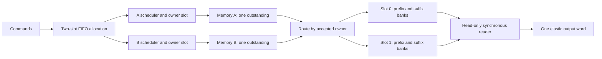

# Stage 4 architecture checkpoint — two FIFO-ordered buffers

2026-10-21. The user requested moving to the next phase after the completed timing checkpoint. This document makes the next architecture concrete for review. **It is a proposed implementation contract, not implemented RTL or a simulation result.** The prior 1,308-run evidence remains intact. Automatic mode selection and physical memory integration are excluded.

## Recommended design and interfaces

Add one common `buffered_transfer_controller` with compile-time `BUFFER_COUNT=1 or 2`, `MODE=0/1/2` (A-only/B-only/hybrid), `BLOCK_WORDS=N`, `SPLIT_WORDS=S`, and `EARLY_DELIVERY=1` by default. The new module defaults to two slots; retain the existing single-buffer modules unchanged as references. A one-slot configuration of the new core must reproduce the historical controller's public-channel behavior before comparing capacities.

Use the same allocation, bank geometry, reader and pipeline for all modes. Only request mapping and response-to-bank mapping depend on mode. N stays a power of two in 1..256, S stays in 0..N, and words remain 32 bits. Reject unsupported parameters, misaligned commands and address overflow explicitly. No runtime mode or split changes.

| Channel | Fields | Proposed change |
| --- | --- | --- |
| Command | `cmd_valid`, `cmd_ready`, `cmd_base_word[31:0]` | Ready when at least one slot is free in pre-edge state; up to two commands may be allocated. |
| A/B request, each | `req_valid`, `req_ready`, `req_base_word[31:0]`, `req_words[8:0]` | Ports unchanged. One accepted outstanding request **per interface globally**, across both slots. |
| A/B response, each | `rsp_valid`, `rsp_ready`, `rsp_data[31:0]`, `rsp_last` | Ports unchanged, ordered, no IDs. Internal accepted-request owner identifies destination slot. |
| Output | `out_valid`, `out_ready`, `out_data[31:0]`, `out_last` | Same FIFO block/word order, at most one word per cycle. Only the oldest allocated slot supplies reads. |
| Clock/reset | `clk`, synchronous active-high shared `rst` | Same cancellation contract, expanded to both slots and new ownership state. |

A-only/B-only still issue one full N-word request per command on the selected interface. Hybrid issues A(base,S) and B(base+S,N−S); an empty segment issues no request. A command accepted at c cannot generate a request handshake before c+1. A response written at w cannot be consumed before w+2.

The important concurrency is between stages: one slot can fill while the other drains. A may serve the second block while B still serves the first. Completing a fill does not release a slot.

## Ownership, request scheduling and simultaneous events

Per slot retain allocated flag, base address, issued flags for the nonempty segment(s), committed prefix/suffix counts, read-issued count and consumed count. Completion derives from accepted counts, not a separate guessed ready time. FIFO head/tail pointers and a count in 0..BUFFER_COUNT track age and capacity; pointer logic wraps explicitly and supports depth one safely.

Each interface retains `{active, owner_slot, expected_length, received_count}` from request acceptance through its final response handshake. Select the **oldest allocated slot whose segment on this interface is unissued**. Do not wait for the other interface or for the FIFO head to drain. Never schedule an unallocated command.

An idle interface may offer the selected request immediately from registered slot metadata, preserving the c+1 earliest request edge. If it is stalled, lock that selection and descriptor in a pending-request register until acceptance. A change of FIFO head, simultaneous enqueue, or slot reuse cannot change an asserted request. There is no pending request behind an already active owner: only select after the previous request completes. At acceptance, mark the slot issued and latch the active owner; at final response handshake, clear that owner. The next request can accept on the following edge, never the same final-response edge. No new external request IDs are required.

| Pre-edge condition/event | Action at the edge |
| --- | --- |
| Queue empty and command handshakes | Allocate tail, clear that slot's counters/issued flags, advance tail; it becomes head. No request/read bypass. |
| One slot occupied, enqueue and head retirement together | Allocate the already-free slot and retire the old head; advance both pointers; occupancy is unchanged. |
| Both slots occupied and head retires | `cmd_ready` was low; no replacement command accepts on this edge. The freed slot is available on the next edge. |
| New request and response on the other interface | Both proceed independently using their own recorded owners. |
| A response for slot 1 and B response for slot 0 | Write the corresponding banks in those different slots. Output still follows the FIFO head. |
| Final response arrives | Update committed count and release interface ownership; keep the slot allocated until final output consumption. |
| Final output is held by backpressure | Keep slot, output tag/data/last and head unchanged, even if both slots are fully filled. |

Use `occupancy_next = occupancy + enqueue − retire` with widened arithmetic. Do not let separate nonblocking assignments lose a simultaneous increment/decrement. Allocation clears only a slot that was free before the edge. No read, write, pending descriptor or active response may reference a freed/reallocated slot. A retiring head cannot also be a current response destination: its final word had to commit before its final read and output handshake.

## Storage, validity and synchronous handoff

Each slot has a prefix bank of S words and a suffix bank of N−S words. Each nonempty physical bank has one synchronous write port and one enabled synchronous read port, using the existing `sync_bank`. At depth two there are up to four banks. Hybrid's A/B writes target different banks; a baseline routes its one response stream across the same partition. Only one read is issued globally per edge.

Logical assembly data storage is `BUFFER_COUNT × N × 32` bits: depth two doubles the data capacity for **every mode**. Include bank output registers, tags and metadata separately; do not infer an actual BRAM count or equal synthesized cost. The unchanged memory-model response holding registers remain outside this assembly-buffer budget.

A word is readable only if its index is below the appropriate **pre-edge committed count of the head slot**. The non-head slot can be partially or completely filled but cannot issue reads. `EARLY_DELIVERY=0` additionally requires all N words of the head to be committed; it does not change allocation, request issue, writes or prefetch capacity.

Retain the one-word elastic output using the selected bank's registered read data, with registered `{output_slot, output_bank, last, valid}`. Do not add an unconditional data stage. When output stalls, issue no read into any bank and hold selection/metadata. The word in a bank's output register is counted once as unconsumed data, not as a second copy in occupancy statistics.

At final head consumption edge t, release that slot and advance head. Do not pre-read the next slot on t. If its first word was committed, read it at t+1 and consume it at t+2. This preserves the existing handoff convention and avoids mixing an additional boundary-bypass optimization into double buffering.

Required invariants include:

- Allocated flags sum to FIFO occupancy; occupancy never exceeds capacity.
- Every active/pending owner references an allocated slot; issued flags prevent duplicate requests.
- Committed counts stay within bank lengths. Each expected response writes exactly one address; last matches the requested length.
- Per slot, `consumed <= read_issued <= N`; every issued read used valid pre-edge data. Non-head slots have issued/consumed counts zero.
- Across allocated slots, `sum(read_issued − consumed) == output_valid`; at most one output is held.
- A slot retires only after all N responses, reads and output handshakes complete, with no pending/active owner remaining.
- No same-address read/write collision is required for correctness. Stalled request and output fields remain stable.

## Hand-derived eight-word, two-block example

**Proposed expected trace, not executed Stage 4 evidence.** Use P0, N=8,S=3, A L=2/I=3, B L=6/I=1, no gaps/cooldown/acceptance stalls, sink always ready. Accept block 0 (base 256) at edge 0 and block 1 (base 264) at edge 1. `b0:w3` denotes address 259; `b1:w3` denotes address 267. Unlisted actions are idle.

| Edge | Accepted command/request | Response write(s) | Synchronous read issued | Consumed output |
| --- | --- | --- | --- | --- |
| 0 | cmd b0 → slot 0 | — | — | — |
| 1 | cmd b1 → slot 1; A0(256,3), B0(259,5) | — | — | — |
| 3 | — | b0:w0 | — | — |
| 4 | — | — | b0:w0 | — |
| 5 | — | — | — | b0:w0 |
| 6 | — | b0:w1 | — | — |
| 7 | — | b0:w3 | b0:w1 | — |
| 8 | — | b0:w4 | — | b0:w1 |
| 9 | — | b0:w2, b0:w5 | — | — |
| 10 | A1(264,3) | b0:w6 | b0:w2 | — |
| 11 | — | b0:w7 | b0:w3 | b0:w2 |
| 12 | B1(267,5) | b1:w0 | b0:w4 | b0:w3 |
| 13 | — | — | b0:w5 | b0:w4 |
| 14 | — | — | b0:w6 | b0:w5 |
| 15 | — | b1:w1 | b0:w7 | b0:w6 |
| 16 | — | — | — | b0:w7; retire slot 0 |
| 17 | — | — | b1:w0 | — |
| 18 | — | b1:w2, b1:w3 | b1:w1 | b1:w0 |
| 19 | — | b1:w4 | b1:w2 | b1:w1 |
| 20 | — | b1:w5 | b1:w3 | b1:w2 |
| 21 | — | b1:w6 | b1:w4 | b1:w3 |
| 22 | — | b1:w7 | b1:w5 | b1:w4 |
| 23 | — | — | b1:w6 | b1:w5 |
| 24 | — | — | b1:w7 | b1:w6 |
| 25 | — | — | — | b1:w7; retire slot 1 |

A changes request owner at edge 10 while B still belongs to slot 0. At edge 12 the next block starts arriving while the current block is draining. At edge 18 the prefix bank reads address 1 and writes address 2, which uses the specified ports without relying on read-during-write behavior. There is no output on edge 17 despite the prefetched prefix; the synchronous handoff is intentional. If another command were offered while full, it could first occupy freed slot 0 at edge 17, but that third command is absent from this example.

## Reset and verification before performance claims

Shared synchronous reset cancels both allocated blocks, pending requests, active owners, counters, FIFO pointers and output validity, plus both memory models, their rows/holding registers/calendar epoch, sink, driver and scoreboard. Do not reset bank data arrays or depend on their stale outputs. The driver must explicitly reissue work with fresh addresses in reset tests. Controller-only reset with live memory responses remains unsupported.

Implement and verify incrementally after this architecture review:

1. Add the common core and depth-one mode. Run existing regression/lint/smoke; demonstrate public request/response/output cycle equivalence to each old controller at depth one, including early-off and endpoints. Keep historical files/results unchanged.
2. Add depth two; verify the exact trace above, back-to-back allocation, overlapping next-block fetch/current-block output, independent owners, FIFO head blocking, both slots full and long/final output stalls. Explicitly witness simultaneous enqueue/retire with occupancy one, full-queue retirement followed by allocation, and repeated pointer wrap/reuse.
3. Cover N=1,2,8,256; S=0,1,N−1,N as legal; all modes and both early settings. Test A-first/B-first, delayed request acceptance with pinned descriptors through head changes, both interface response writes and cross-slot writes, and no read of same-edge writes.
4. Reset while both slots are occupied, while either interface owns the tail, while a request is stalled, during row setup/maintenance, and with head final output held. Verify no stale response/output or validity survives. Retain model reset/trace-error checks.
5. Reuse the unchanged address-only scoreboard: its accepted-command address queue already handles two outstanding blocks. It must receive no slot, split, response, row or timing state. Add a separate public-channel command/owner ledger for mapping, counts, slot-capacity and timing checks. Assertions may inspect internal invariants but cannot define expected output data.
6. Add named negative test variants for wrong destination ownership, premature slot reuse, invalid/uncommitted read, request/output instability, wrong order/last, duplicate/drop/stale data. Require the intended diagnostic and nonzero status; preserve failing waves/configurations. A timeout alone is not checker success unless the deliberate missing-final-word test names that no-progress condition.
7. Exercise P0 and fixed/seeded P1–P3 schedules; derive finite run/progress bounds for two queued blocks and reject zero-progress environments. Only passing, source-matched RTL builds may enter performance comparisons.

No Stage 4 check above has run at this checkpoint. The existing one-slot suites remain historical evidence for their recorded sources.

## Benchmark contract changes needed for two slots

Create a new depth-aware harness/runner and result directory, proposed `results/raw/double_buffer/`. Preserve all existing runners, inputs and saved reports. Compare a matched six-run set: A-only/B-only/hybrid at depth one and at depth two. Within each depth, capacities and prefetch opportunities match; across depths, storage increases from N to 2N words explicitly. Report both effects separately:

- Hybrid versus A-only and B-only **at the same depth**.
- Depth two versus depth one **within the same mode**, with the doubled-storage cost stated.

Keep workload addresses/releases, sink readiness, memory profiles and external calendars identical across all six runs, indexed by the same reset-relative clock. Slot availability changes command acceptance and therefore sampling/row/grant history naturally. Do not reset calendars at block boundaries or warmup completion. Retain P3's existing service cap and arbitration unchanged; outstanding capacity remains one per interface globally.

The historical single-slot benchmark cannot simply have a parameter changed: its monitor forbids a command while any owner exists, and assumes all responses belong to its sole current block. Replace those assumptions only in the new harness with an accepted-command FIFO and per-interface request-owner ledger. Retain the independent end-to-end oracle.

Two slots also invalidate several single-slot measurement identities:

- Post-edge allocated occupancy is accepted commands minus completed outputs, bounded by 0..BUFFER_COUNT. A single-slot formula such as `slot_sum=last+1−completed_blocks` no longer applies. Log slot-cycle sum, average and maximum directly.
- Assembly backlog Q is accepted responses minus consumed words across all allocated slots, including held output once. Bound Q by BUFFER_COUNT×N. It can be nonzero at the warmup boundary because measured blocks were prefetched.
- For window `(d_warmup,d_end]`, retain **`responses_window − outputs_window = Q_end − Q_start`**. Do not demand responses_window=measured_words. For model holding words H, independently retain **`grants_window − responses_window = H_end − H_start`**. Count edge events and take snapshots consistently after applying that edge's handshakes/grants.
- P0 exposes no separate transport grants or response holding registers: leave those metrics not applicable and retain its exact response-timing checks. The grant/holding identity above applies to P1–P3.
- Similarly, `commands_window − completed_blocks_window = occupancy_end − occupancy_start`. First/last response timestamps remain associated with their owning command, even when responses precede that command's turn at the head.
- Throughput still uses measured output words divided by all cycles in the same open-left/closed-right window. Useful/unavailable/intentional/held definitions stay unchanged. At final drain Q, H and occupancy must be zero; exclude quiet-tail cycles.
- Report command-to-first/completion and request-to-first/completion distributions, plus first-valid/handshake times. Accepting a second command earlier includes more FIFO waiting in its command-relative latency; do not disguise that as a memory-latency regression or change its origin to head activation.

Recommend reusing the complete existing case lists at both depths: 26 P0 configurations plus 410 new-profile configurations, each with three modes × two depths: **2,616 planned performance runs**, after correctness. This preserves early-off controls, endpoints, startup/doubled windows, favorable/unfavorable splits, slow sinks, all recorded address patterns and four disturbance seeds where previously included. The nominal aggregate-rate control stays supplementary; do not reinterpret it as equal available bandwidth after reservations. Freeze the matrix before runs; any runtime reduction must be documented before observing results.

For the new depth-one core, require exact per-block public timestamp/counter equivalence to the saved reference for the shared fields; new occupancy/boundary counters can be additional columns. A depth-one mismatch is a compatibility failure to resolve, not a double-buffer result. Report paired integer win/tie/loss against both baselines, means and tails, trace ranges, and window-sensitive cases as before. Do not assume more prefetch always wins under phase-dependent timing.

## Checkpoint and decision

Prepared: concrete ports/parameters, ownership and simultaneous-edge rules, RAM ports and validity, reset, two-block transaction table, verification gates and corrected benchmark accounting. No new RTL, simulation or performance evidence is claimed. Existing implementation/results are preserved.

Three understanding questions:

1. Why does each memory interface need an owner slot even though the external responses have no IDs?
2. Why must a slot remain allocated while its final output word is stalled, even if every memory response has arrived?
3. Why can a correct two-slot steady window consume more words than it receives from memory during that same window?

Implementation checkpoint, 2026-10-22: this approved contract is implemented and its fixed matrix completed. The hand-derived transaction example above now matches actual RTL events. See [results](stage4-results.md). The original proposal text is retained for traceability; its earlier “not implemented” statements describe the architecture-review date.
