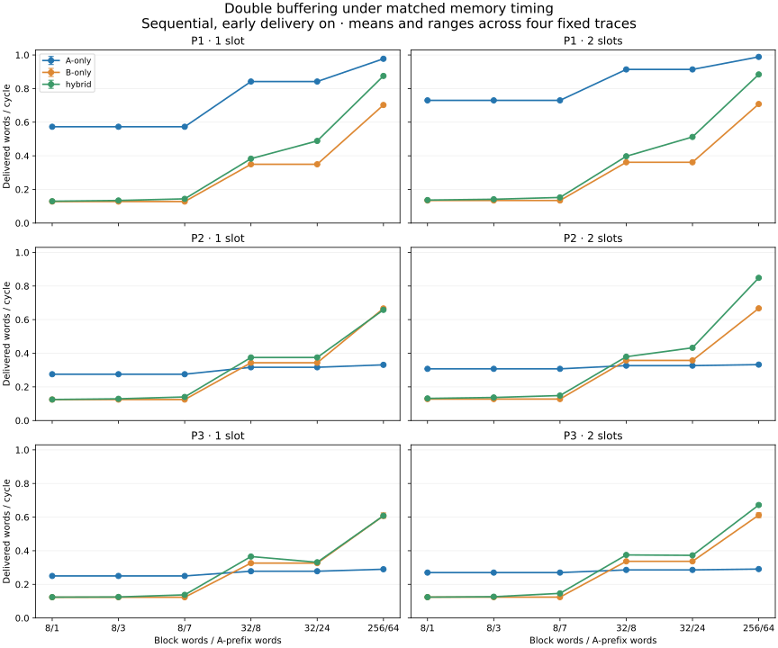
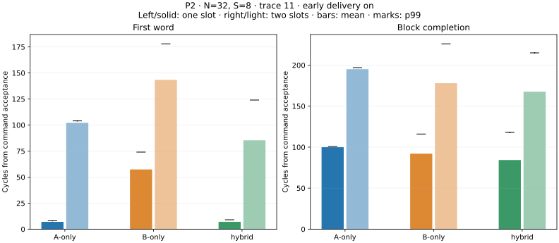

# Stage 4 implementation and evaluation — 2026-10-22

All **2,616 actual RTL benchmark runs** pass, covering 436 matched six-run sets and **98,755,968 independently checked output words**. All **1,308 depth-one runs** match every shared historical per-block field and compare public channels against the original controller every edge. No benchmark case was removed. Source/input hashes, pairing, endpoint equivalence and result-file hashes pass the final audit.

See [complete tables](../results/double-buffer-tables.md), [per-run metrics](../results/double-buffer-metrics.csv), [paired comparisons](../results/double-buffer-comparisons.csv), [depth effects](../results/double-buffer-depth-effects.csv), [early controls](../results/double-buffer-early-controls.csv), [trace ranges](../results/double-buffer-trace-ranges.csv), raw report (development archive) and audit (development archive).

## What changed, and what survived

These are **steady-window** classifications against both baselines at the **same capacity**. P0 uses its 20 primary configurations; each P1–P3 row uses six recommended sequential splits × four external traces with early delivery on. Controls, other workloads and longer windows remain separate in the complete tables. W/T/L means fewer/equal/more cycles for the same output count; there is no tolerance that relabels small losses as ties.

| Profile | Slots | Hybrid vs A W/T/L | Hybrid vs B W/T/L | Beats both |
| --- | ---: | --- | --- | ---: |
| P0 original | 1 | 13/5/2 | 5/7/8 | 3/20 |
| P0 original | 2 | 15/3/2 | 10/4/6 | 8/20 |
| P1 quiet independent | 1 | 0/0/24 | 24/0/0 | 0/24 |
| P1 quiet independent | 2 | 0/0/24 | 24/0/0 | 0/24 |
| P2 local reservations | 1 | 12/0/12 | 19/0/5 | 8/24 |
| P2 local reservations | 2 | 12/0/12 | 24/0/0 | 12/24 |
| P3 shared return | 1 | 12/0/12 | 19/1/4 | 10/24 |
| P3 shared return | 2 | 12/0/12 | 21/2/1 | 12/24 |

Counts describe these experiments, not probabilities. The historical P0 whole-time H-versus-B count was 6/6/8; its steady count is 5/7/8 because request_skew's three-cycle startup advantage does not improve its steady rate.

- **P0 default improves against a strengthened B baseline.** At N=8,S=3, A/B/hybrid rates change from 0.296296/0.470588/0.470588 to 0.333333/0.571429/0.727273 words/cycle. Hybrid now beats both at equal depth. S=1 was faster than S=3 with one slot (0.500000 versus 0.470588); with two slots, S=3 is faster (0.727273 versus 0.615385). Split choice depends on buffering as well as memory timing.
- **Bad splits remain bad.** P0 S=7 still loses to B: 0.380952 versus 0.571429 at two slots. The oversized slow prefix remains much worse: hybrid 0.156863 versus B 0.800000. Very late B still makes hybrid lose to A: 0.177778 versus 0.888889. Buffering is not a universal cure for the selected source split.
- **Full-rate resident A remains the best quiet sequential baseline.** P1 hybrid loses to A in all 24 recommended cases at either depth. For N=32,S=8, trace 11, two-slot A/B/hybrid rates are 0.914082/0.361658/0.397366. Reporting only the B comparison would hide this limitation.
- **The large-block P2/P3 conclusion changes.** N=256,S=64 loses to B on all four P2 traces at depth one, but beats both baselines on all four at depth two; P3's mixed B comparison also becomes four wins. P2 trace 11 moves from A/B/H = 0.331194/0.666660/0.658200 to 0.332467/0.666662/0.844708. For hybrid, ready-but-unavailable cycles per block fall from 132.939 to 47.063. Prefetching the next prefix while the current block drains hides work that the one-slot reader previously waited for. This interpretation is consistent with the ownership trace and public counters; it is not a physical-device explanation.
- **Small recommended blocks still lose to A in P2/P3.** The remaining P3 two-slot H-versus-B loss is N=8,S=1, trace 83: 65,535 versus 65,534 steady cycles. Traces 11 and 47 tie B for that split. These close B results do not change A's much stronger performance on those cases.
- **Consumer limits can erase the hybrid advantage.** At N=256,S=64 with one ready edge per 16 cycles, two-slot A, B and hybrid all deliver exactly 0.0625 words/cycle in P1–P3. At depth one B was slower (0.061450, 0.061556 and 0.061538 respectively). Fair prefetching lets B catch up. The original P0 slow-sink tie also survives.
- **The nominal aggregate-rate control reverses in P0.** It changes from hybrid losing to both (0.615385 versus 0.864865) to winning (0.969697 versus 0.941176). This separately labeled control gives hybrid I=2 on both interfaces versus I=1 for each baseline; it is excluded from the primary counts and does not establish equal hardware cost or equal available service after reservations.

Across all 1,308 same-mode/configuration comparisons, two slots are faster in 1,231, tie in 69 and are slower in eight. The losses are only 1–18 cycles over windows of at least 63,487 cycles, but are retained as losses. Seven occur under P3 and one in P1's long request-skew B-only control. Earlier admission changes sampled timing phases; the data do not establish monotonic improvement for every finite window.

## First-word latency, completion and variability

In P0 default, initial first-word timing is preserved by adding capacity: A/B/hybrid still first consume at 5/9/5. However, steady command-relative latency includes the extra block accepted into the queue. For hybrid, mean command-to-first changes from 5 to 12 cycles and command-to-completion from 16 to 21 while throughput improves from 0.470588 to 0.727273. This does not mean memory became slower; depth one excludes waiting outside the controller from its acceptance-relative clock. These are not release-to-completion application latency claims.

For P2 N=32,S=8, trace 11, early on:

| Slots | Mode | Initial first word | Mean command→first | Mean command→complete | p99 command→complete | Steady words/cycle |
| --- | --- | ---: | ---: | ---: | ---: | ---: |
| 1 | A-only | 6 | 7.021 | 100.021 | 101 | 0.316764 |
| 1 | B-only | 69 | 57.317 | 92.094 | 116 | 0.343740 |
| 1 | hybrid | 6 | 7.046 | 84.331 | 118 | 0.375010 |
| 2 | A-only | 6 | 102.110 | 195.110 | 197 | 0.326352 |
| 2 | B-only | 69 | 143.414 | 178.073 | 226 | 0.357425 |
| 2 | hybrid | 6 | 85.322 | 167.658 | 215 | 0.379435 |

The two-slot hybrid wins mean completion and throughput against both, but its p99 completion is worse than A's (215 versus 197). The one-slot hybrid's p99 loss to B (118 versus 116) becomes a two-slot p99 win over B (215 versus 226) while the A comparison still matters. Reported distributions include min, median, mean, p95, p99 and max for command and request origins, plus request-to-first-valid/response timing.

For that two-slot hybrid case, 32-block rates within trace 11 range from 0.369542 to 0.397053. Its full-window rates across the four traces range from 0.378803 to 0.380422, and completion p99 ranges from 206 to 215. P3's corresponding full-window rate range is narrow, 0.374903–0.375126, while p99 spans 189–223. Rate stability alone does not imply stable tails. Whiskers and ranges describe four reproducible schedules, not statistical confidence intervals.

**Three longer-window ranking flips remain explicit.** The historical depth-one P3 sequential N=8,S=3, trace 29, early-on comparison changes from losing to B by nine cycles to winning by seven. At depth two, conflict-access N=8,S=3, trace 29, both early settings change from beating B by four cycles over 1,024 measured blocks (87,375 versus 87,379) to losing by one over 2,048 (174,772 versus 174,771). These are fragile phase/window results, not robust advantages.

## Early-delivery controls

With one slot, early-on is faster in 518 of the 522 paired mode/configuration controls and ties four. With two slots, P0/P1/P2's 342 paired controls all tie in steady throughput. Prefetching has hidden the full-block wait in those measured windows. P3's 180 two-slot controls give early-on ten wins, 163 ties and seven losses, reflecting changed phase and service history.

Throughput ties do not imply identical first-word timing. P0 default two-slot hybrid starts at cycle 5 with early-on versus 13 with full-block wait. Its steady mean command-to-first is 12 versus 14; both have mean completion 21 and rate 0.727273. The required early-validity mechanism remains enabled by default. No decision to remove it or select modes automatically follows from these results.

## Implemented architecture

`buffered_transfer_controller` supports BUFFER_COUNT=1/2, MODE=0/1/2 for A-only/B-only/hybrid, power-of-two N in 1..256, S in 0..N, and EARLY_DELIVERY=0/1. One common allocator, bank arrangement and reader serves every mode. The original controllers, memory models, scoreboards, benchmark runners and saved evidence remain references.

Each interface selects the oldest allocated, unissued segment and records its accepted destination. Pending requests lock their selected slot; the slot's immutable base and compile-time segment length keep the descriptor stable without duplicating its payload registers. The expected response length is constant per interface/mode. This implements the approved ownership contract without changing external ports.

Only the FIFO head reads. A response at edge w increments a committed prefix/suffix count; a synchronous read can first issue at w+1 and consumption at w+2. A held final word retains the slot. Full-queue retirement does not accept a replacement on the same edge. If occupancy is one, allocation into the other free slot may coincide with retirement. Retirement at t permits the next head's first read at t+1 and first consumption at t+2.

Shared reset clears validity, occupancy, owners, pending descriptors and counters across the controller, both memories, calendar, sink, driver and checker. RAM arrays remain unreset. Controller-only reset with live responses is unsupported.

## Executed correctness evidence

- 205 positive Stage 4 native RTL cases pass, including every distinct split in {0,1,N−1,N} for N=1,2,8,256 across all modes, both depths and both early settings under stalls. All modes and early settings also pass P0–P3 directed and reset cases.
- 21 additional outcomes pass: 11 positive ownership/reset witnesses and ten named expected failures. Witnesses include independent owners, overlap, pointer reuse, simultaneous enqueue/retire, stalled final output, pending request across head retirement, and reset during B row setup and maintenance.
- Three unsupported BUFFER_COUNT/MODE configurations fail with their intended parameter diagnostics.
- Ten accounting tests pass using the actual RTL hand trace and damaged records. The measured second block receives fewer than eight words inside its nine-cycle window because its prefetched backlog is nonzero at the cut.
- The original 68 baseline/hybrid outcomes, 28 timing-model outcomes, 31 timing-integration outcomes, original eight accounting tests, timing eight accounting tests, smoke and strict lint pass.

The hand-derived example is now executed RTL evidence: block 0 consumes at 5,8,11,12,13,14,15,16; block 1 at 18,19,20,21,22,23,24,25. A accepts the second prefix at 10 while B still owns block 0; B accepts the second suffix at 12. The synchronous handoff deliberately has no output at 17.

The unchanged address-only scoreboard derives expected words only from accepted commands. The additional public ledger assigns requests and responses to command ordinals; DUT internal observations serve structural assertions and coverage only. Test-only source mutations and scoreboard-input wrappers are isolated from production RTL and every performance run. The missing-output wrapper suppresses the entire checked output stream and verifies the remaining expected-address queue; it is not presented as an exhaustive per-word drop campaign. Stage 5 still owns broader seeded stress and fault exploration.

## Evaluation scope and accounting

See execution plan (development archive) and [approved contract](stage4-contract.md). The unchanged benchmark plan is 436 configurations × two depths × three modes, 2,616 RTL runs. Every depth-one run compares public channels against the old core each edge and shared per-block fields against historical records. Two-slot cases use explicit occupancy, backlog and holding conservation.

All six members share source placement, memory timing, ordered workload, sink readiness, external trace and outstanding limits. They naturally generate different request times and arbitration/row histories. Four trace ranges are not confidence intervals. Assembly data capacity doubles for every mode, from N×32 to 2N×32 bits, plus output registers/metadata; hybrid's two interfaces do not imply equal hardware cost.

Command-relative latency includes FIFO waiting after earlier admission into slot 2. Request-relative distributions are retained separately. P0 has no public transport grant metric. Original model row/per-interface-grant snapshots retain their pre-edge convention for compatibility; the new post-edge public `grant_count` drives service and holding conservation.

The first sweep encountered a native compiler time limit, recorded in `build/stage4-benchmark-interrupted.log`. The resumed sweep completed all cases without changing RTL or dropping configurations. All passing correctness reports still match current sources. Final strict lint covers the original seven tops plus four new depth/profile elaborations, and each native benchmark build uses strict warnings.

The preservation audit compares 4,273 previously protected files: the only changed pre-existing implementation/script/result file is `scripts/lint.sh`, extended to cover the new top. All historical RTL, models, scoreboards, runners and results, including `docs/results.md`, are byte-identical. New evidence is separate under `results/raw/double_buffer/` and `docs/validation/stage4/`.

## Review checkpoint and next decision

The approved Stage 4 contract is complete without external-interface changes beyond its explicitly approved two-command capacity. One request per interface globally, synchronous reads, head ordering, pending stability, reset cancellation and the boundary bubble remain in place. No extra architectural optimization was folded into buffering.

A short walkthrough: the allocator accepts two blocks; A and B independently fill the oldest unissued segment. Each response returns to its recorded owner, even when the interfaces serve different slots. The reader consumes only committed head data. A stalled final word holds ownership. After retirement, the prefetched next head begins its synchronous read on the following edge. The address-only checker verifies the resulting ordered stream, while public counters account for prefetched data across measurement boundaries.

Three understanding questions:

1. Why can A and B need different owner slots even though each interface returns ordered responses?
2. Why can two slots improve throughput while increasing command-to-first-word latency?
3. Why can a steady window consume more words than it receives, and which boundary state makes the counts balance?

Limits remain: finite directed verification rather than exhaustive/formal proof; four external traces; fully replicated immutable source data with preload costs excluded; no useful compute workload or finite A placement study. No physical hardware performance, synthesis, BRAM inference, resource utilization, timing closure or novelty is claimed.
