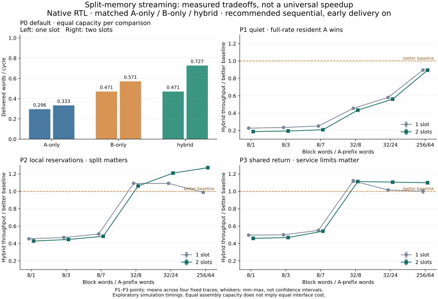

# Stage 6: completed core evaluation — 2026-11-02

The core result is conditional: overlapping two memory paths and two assembly slots can improve an ordered stream, but the better single-memory baseline often wins. The engineering contribution demonstrated here is the implementation, verification and fair characterization of that tradeoff. It is not a novelty claim or a measured hardware speedup.



## Evidence and headline results

The [new report](../results/core-results.md) consolidates all **2,616 preserved native RTL benchmark runs**, representing 436 configurations × three modes × two capacities. The new audit recomputes every stored metric from the per-block CSV, validates the exact matrix and current source/input hashes, checks native PASS markers and per-run summaries, and rechecks all **1,308 depth-one records** against historical shared fields. The native campaign checked **98,755,968 output words**. These are preserved simulation results, not 2,616 newly executed simulations.

| Matched primary cohort | Hybrid beats both, one slot | Hybrid beats both, two slots |
| --- | ---: | ---: |
| P0 original configurable timing | 3/20 | 8/20 |
| P1 quiet independent, recommended sequential | 0/24 | 0/24 |
| P2 local reservations, recommended sequential | 8/24 | 12/24 |
| P3 shared return, recommended sequential | 10/24 | 12/24 |

P1–P3 each use six fixed geometries/splits and four declared disturbance traces, with early delivery on. Counts describe sampled cases, not probabilities. The complete tables retain both A-only and B-only comparisons; aggregate-rate, early-off, locality, slow-sink and window controls remain separately labeled.

In the P0 default at two slots, A/B/hybrid deliver **0.333333 / 0.571429 / 0.727273 words per cycle**. Hybrid is 27.3% faster than B-only in that case. At one slot, hybrid and B-only both deliver 0.470588. Conversely, full-rate resident A wins every recommended quiet P1 sequential comparison, and small P2/P3 blocks still lose to A. A favorable P0 example is not evidence of a universal advantage.

## What buffering and early reads actually change

Two slots improve 1,231 of the 1,308 within-mode comparisons, tie 69, and regress eight. Every regression remains in the [generated table](../results/core-results.md#every-depth-regression) with its case, mode and exact cycle delta. The losses are 1–18 cycles, driven by changed finite-window timing histories; the experiment does not establish monotonic improvement for every case.

The first output in P0 default remains A/B/hybrid = 5/9/5 cycles at both capacities. For hybrid, mean command-to-first rises from 5 to 12 cycles and command-to-completion from 16 to 21 while throughput rises. Slot two accepts a command earlier and therefore includes more queue waiting in acceptance-relative latency. A queue cannot be evaluated solely by the time measured after it accepts work. Application release-to-completion latency remains outside this core matrix.

Early delivery is faster in 518 of 522 one-slot controls and ties four. At two slots, the same controls produce ten wins, 505 ties and seven losses. Prefetching often hides the full-block wait in steady throughput, but startup still matters: P0 default hybrid first outputs at cycle 5 with early reads versus cycle 13 with full-block wait. Early delivery remains the default, and no automatic selection or boundary bypass was introduced.

## Locality, tails and fragile rankings

The [workload comparison](../results/core-results.md#workload-sensitivity-at-a-fixed-geometry) holds N=8, S=3, two slots and early-on fixed across sequential, permuted, conflict and expanded access, and compares all modes within each trace. The complete CSV additionally contains the 32-word locality cases and all other split/profile/depth controls. Permuted access retains the original footprint; conflict and expanded workloads deliberately change locality/footprint and are not interchangeable with it.

Mean throughput does not determine tail behavior. P2 N=32,S=8, trace 11, two-slot hybrid beats both baselines in steady throughput and mean command-to-completion, but its p99 completion is **215 cycles versus A's 197**. B's p99 is 226. Both comparisons are needed to describe the result accurately.

Three hybrid-versus-baseline classifications flip when the measurement window doubles. At depth one, P3 N=8,S=3 sequential trace 29 changes from a nine-cycle loss to B into a seven-cycle win. At depth two, the corresponding conflict-access case changes from a four-cycle win into a one-cycle loss, in both early states. These are phase/window-sensitive rankings, not robust performance advantages. Four-trace min–max ranges describe fixed schedules; they are not confidence intervals.

The core export distinguishes whole-run and steady comparisons. The original P0 request-skew case's three-cycle startup advantage is not a steady-rate advantage. Startup, admission-relative latency, and sustained useful-word rate answer different questions.

## Reproduction and audit integrity

The [execution plan](stage6-execution-plan.md) was recorded before the new analysis. Production RTL, simulation models, benchmark runners, fixtures and historical raw evidence were left unchanged. The approved matrix already contained the Stage 6 comparison axes, so no missing core performance comparison required a new matrix. Current project-wide correctness reruns are recorded separately by the project's validation entry point.

```sh
python3 benchmarks/test_core_report.py
python3 benchmarks/report_core.py --check
# Regenerate the deterministic JSON, CSV and Markdown products:
python3 benchmarks/report_core.py
# Optional standalone PNG/SVG; use the pinned plotting environment:
.venv/bin/python benchmarks/report_core.py --plots
```

The audit needs the repository's retained raw evidence, Python's standard library and no build directory or simulator. It never executes absolute historical command lines. `--check` is read-only and rejects stale generated reports. Sixteen analysis-integrity tests cover the complete matrix and native trace as positive controls, plus missing/duplicate cases, wrong configuration/schedule, source changes, altered CSVs, broken conservation even with an updated hash, changed cached metrics, missing PASS evidence and per-run summary disagreement. Python `-O` is rejected because the preserved accounting implementation uses assertions.

The initial report attempt completed the native-record checks but rejected a report grouping assumption: slow-sink controls deliberately have one trace, while the other recommended groups have four. The new report now validates and labels those declared counts separately. No native RTL failure or historical evidence change was involved.

## Resource assumptions and completed scope

Every compared mode has the same assembly data capacity at a given depth: depth × N × 32 bits, plus enabled RAM output registers and metadata. Hybrid has two memory interfaces; equal assembly data bits do not imply equal total hardware area, ports, energy or source-memory cost. One outstanding request per interface, synchronous committed-word reads, stable ready/valid payloads, head-only drain, shared reset and the inter-block bubble remain the common contract.

Both original source stores contain the complete immutable 256 KiB fixture. The core excludes finite A placement, preload, updates and a useful compute consumer. The separately authorized application experiment addresses some of those limitations without changing this reference. No synthesis, BRAM inference, device frequency, timing closure, physical-memory calibration or board operation is claimed. Formal proof and exhaustive randomized coverage are also outside the executed evidence.

The completed core is now a reproducible comparison reference. Further architecture changes must remain separately attributable; results from the application experiment must not be relabeled as core measurements.


## Fresh-source reproduction after consolidation

The prepared public source package subsequently rebuilt the entire evidence chain in a separate directory: 78 original P0 runs, 78 P0 replays, 1,230 profiled runs and 2,616 buffered runs, plus required native correctness suites and the final audits. All 2,616 buffered record CSVs and every stored metric match the development reference exactly; the original P0 and profiled comparisons also match. This confirms the source package can regenerate the evidence without copying the raw archive. It is a rerun of the existing matrix, not an enlarged performance study. Existing source-keyed compiler caches on the same macOS/Verilator host may be reused, so no independent-platform qualification follows. See [reproducibility](reproducibility.md) and the [receipt](../results/reproducibility-summary.json).
